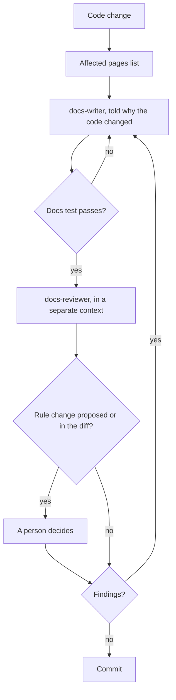
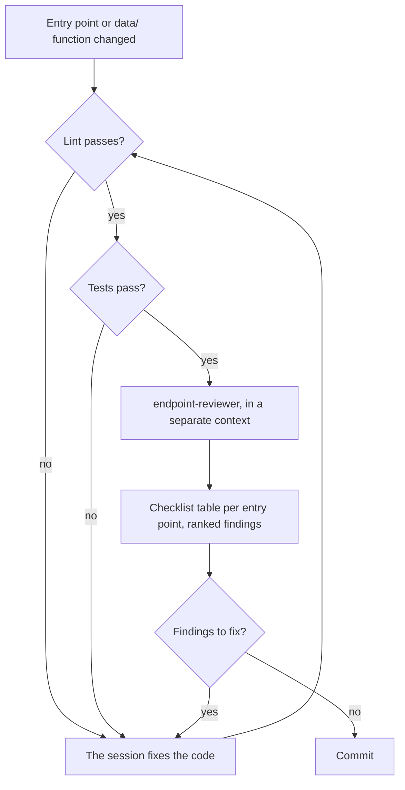

# Coding agents

How the instruction files, skills, subagents, hooks, and machine checks for coding agents fit together, and which flow to follow after a change.

## Parts

| Part | Where | What it does |
| --- | --- | --- |
| Instruction files | `AGENTS.md`, `CLAUDE.md` | `AGENTS.md` holds the structure tree, the commands, and every rule the domains share. `CLAUDE.md` loads `AGENTS.md`, then lists the skills and subagents and when to use each |
| Reference skills | `prisma-cli`, `prisma-client-api`, `supabase-postgres-best-practices` | Prisma CLI and Prisma Client reference, and Postgres schema, index, connection, and RLS design. Schema changes still go through the Prisma schema |
| Procedure skills | `docs-write`, `docs-review`, `endpoint-review` | Step lists for writing the docs, reviewing the docs, and reviewing the security boundary, each ending in a fixed report |
| Subagents | `.claude/agents/` | `docs-writer`, `docs-reviewer`, and `endpoint-reviewer`, each running one procedure skill in a context of its own |
| Hooks | `.claude/hooks/` | Scripts the subagents run before a tool call, which block what the subagent may not do |

The skills live twice, in `.claude/skills/` and `.agents/skills/`, because agents look for skills in one folder or the other; keeping them identical gives every agent the same procedures. The docs test fails when the two folders differ in any file, and when a skill or subagent is missing from the list in `CLAUDE.md`.

## Writing and review

Each kind of work runs where it has what it needs.

- **Writing stays where the reason is known.** Docs explain why code works as it does, and only the session that made the change knows why. That session runs `docs-write` itself or hands `docs-writer` the change and its reason in the request. Without a reason, the writer describes only what the code does and reports the gap.
- **Review runs in a separate context.** The subagents start without the conversation, `CLAUDE.md`, or the user's global instructions, read `AGENTS.md` themselves (the docs subagents also read the writing rules), and take the repository as their only source. A review then judges the result, not the intent it was told.
- **Reviewers are read-only.** `docs-reviewer` and `endpoint-reviewer` have no edit tools; fixes go back to the writer or to the session that made the change.
- **Rules are a person's decision.** `docs-writer` never adds, removes, or rewords a rule in `AGENTS.md`, a `## Domain rules` section, or "Writing these docs"; it proposes the change in its report. `docs-reviewer` lists any rule change in the diff first in its report, even when it looks right.

## Machine checks and review scope

What a machine can check is a test or a lint rule, and the reviewers check only what those cannot. Both review skills name what is out of their scope, so a finding is never a repeat of a failing check.

| Check | Runs in | What it enforces | Left to review |
| --- | --- | --- | --- |
| Docs test | `pnpm test:vitest:unit` | Page length and shape, key files that exist, both index tables, links and anchors, Mermaid types, styling, and node counts, the structure tree, environment variable lists, the skill folders, the `CLAUDE.md` list | Whether the text matches the code, and the writing rules no pattern can test |
| `pnpm docs:affected` | By hand, or as the first step of both docs skills | Lists the pages whose key files changed, and the changed files no page lists | Whether an unlisted file should be listed |
| Prisma model test | `pnpm test:vitest:unit` | Where schema blocks go, primary and foreign keys, foreign key and duplicate indexes, snake_case names, timestamps, `Float`, user ID columns, pinned Prisma versions | Whether the model fits the domain |
| ESLint boundary rules | `pnpm lint` | Imports of `db`, Prisma Client values, server secrets, the Redis client, and the `redis` package, including dynamic imports, and how `data/` uses `db` | Whether each `data/` function authorizes the requester for this exact resource |
| ESLint export rules | `pnpm lint` | Every exported Server Action and Route Handler goes through its error handler | Input validation, what reaches the browser, rate limiting |
| ESLint notification rule | `pnpm lint` | App code reaches the notify module only through `import { notify }`, and only in Server Action files and Route Handlers. `defineNotification()`, types, and type-only re-exports import anywhere. Namespace, default, and dynamic imports, `require()`, re-exports from the module, `sendNotification()`, and anything but types from the module's own files are rejected in every file outside `lib/notify/`, `test-utils/`, and tests | Whether `notify()` runs only after the `data/` call has succeeded |

`eslint.config.vitest.test.ts` and `.claude/hooks/*.vitest.test.ts` test the lint rules and the hooks themselves, including the known ways around them.

## Hooks

The hooks are attached in each subagent's own settings, so they apply to that subagent only, never to the session that called it. Each one blocks with exit code 2, and blocks input it cannot read too, because any other exit code would let the call through.

| Hook | Attached to | Enforces |
| --- | --- | --- |
| `docs-writer-scope.mjs` | `docs-writer`, before every edit | Edits only to Markdown in `docs/`, `AGENTS.md`, and `README.md`, so the docs test and tooling stay out of the writer's reach |
| `bash-allowlist.mjs` | All three subagents, before every shell command | Only the read-only git commands, `pnpm docs:affected` with an optional base commit, and the docs test. Any chaining, redirect, substitution, or brace expansion is blocked, as are git options that write a file, also when quoted or abbreviated |

What the hooks cannot do:
- They cannot stop the writer from changing a rule in `AGENTS.md`, a domain page's `## Domain rules` section, or "Writing these docs", since those files are in its scope. That limit rests on the skill and on `docs-reviewer` flagging every rule change.
- They do not limit reading, and they do not apply to the main session.
- Hooks from the user's own settings still run inside the subagents; only turning off all hooks for the session stops them.

## Docs flow

How a code change reaches the docs and is checked.

The writer receives the findings as its request, with their page and line, and the reviewer runs again on the result. A proposed rule change waits for a person, whether the writer proposed it or the reviewer found it in the diff.

## Endpoint flow

How a change to an entry point or a `data/` function is checked.

Lint covers the import boundary, the error handler wrapping, and where `notify()` is imported, so the reviewer starts from code that already passes them. It traces each entry point from its input to the database and back, answers the audit checklist with `file:line` evidence, and checks that each `data/` function has its database test.

## Choosing a subagent

| Subagent | Use it | Tell it |
| --- | --- | --- |
| `docs-writer` | After a change that `pnpm docs:affected` maps to a page, for a new topic or domain page, or to fix `docs-reviewer` findings | The change, why it was made, and the pages or findings to work on |
| `docs-reviewer` | After `docs-writer`, and before committing a change that touches a docs page or a key file | Uncommitted changes, a base commit, or a full review |
| `endpoint-reviewer` | When a change adds or edits an entry point or a `data/` function, and before a release | Uncommitted changes, a base commit, or a full review |

## Key files

| File | Role |
| --- | --- |
| `CLAUDE.md` | Loads `AGENTS.md`, lists the skills and subagents |
| `.claude/skills/`, `.agents/skills/` | The project skills, kept identical |
| `.claude/agents/` | Subagent definitions: tools, preloaded skill, hooks |
| `.claude/hooks/` | Edit scope and shell allowlist for the subagents, with their tests |
| `docs/key-files.mts` | Key files parsing and `pnpm docs:affected` |
| `docs/docs.vitest.test.ts` | Docs test |
| `prisma/models.vitest.test.ts` | Prisma model test |
| `eslint.config.mjs` | Boundary, export, and notification lint rules |

## Related rules

- [Documentation](../AGENTS.md#documentation): reading a page before changing its key files, the docs skills, where domain rules go
- [Security boundary (client → server)](../AGENTS.md#security-boundary-client--server): the audit checklist, the `endpoint-review` skill
- [Server endpoints](../AGENTS.md#server-endpoints): the error handler wrapping that lint enforces
- [Database](../AGENTS.md#database): the model rules the Prisma model test checks
- [Commands](../AGENTS.md#commands): the verify commands, test file naming
