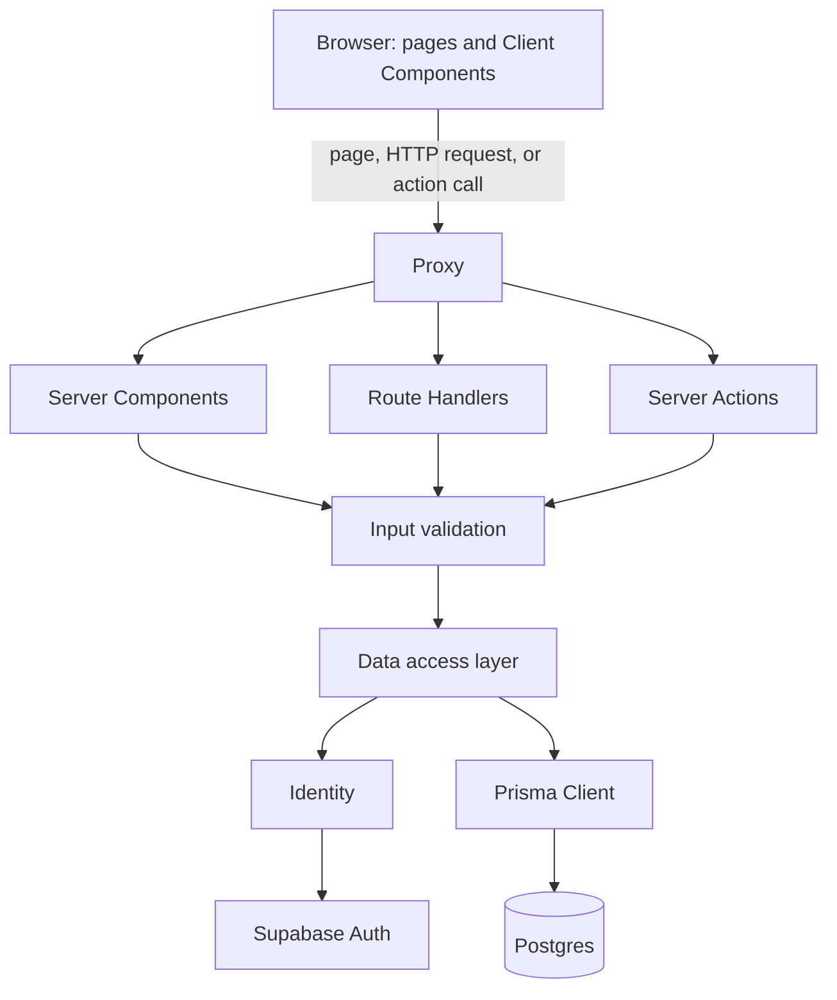
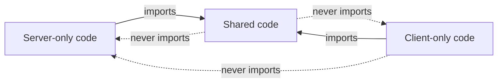

# Architecture

The layers a request passes through, and the boundary between server and client code. Every Server Action and Route Handler is a public endpoint, and Prisma bypasses RLS, so the server code is the only line of defense.

## Layers

Server Components, Route Handlers, and Server Actions are the **entry points**. Each one validates its input, calls the data access layer, and returns only what the UI needs. Nothing above the data access layer queries the database. Only the data access layer decides who may see what, so a new entry point cannot skip authorization by accident.

Lint and tests catch the boundary breaks a machine can see. Whether a data access function authorizes the right resource, or a response holds more than the UI needs, takes reading the code: the `endpoint-review` skill, run by the read-only `endpoint-reviewer` subagent, traces each entry point to the database and back against the audit checklist.

| Layer | Location | Role |
| --- | --- | --- |
| Client Components | `components/`, `hooks/`, `lib/ky.ts` | Call Route Handlers through the HTTP client and Server Actions directly |
| Proxy | `proxy.ts` | Sets the per-request CSP nonce and request ID, and refreshes the session; protects nothing |
| Input validation | `lib/server/validation.ts` | Checks every external input, including page route params, with a strict zod schema |
| Data access layer | `data/` | Identifies the requester, authorizes access to the resource, queries, and returns a DTO |
| Identity | `lib/auth.ts` | Returns the verified requester. See [Auth](auth.md) |
| Prisma Client | `lib/db.ts` | The single database client. See [Data layer](data-layer.md) |

## Server/client boundary

Folders group code by feature, not by runtime. Each module states its runtime with a guard import, so a wrong import fails the build instead of leaking server code into the browser bundle.

Solid arrows are allowed imports; dashed arrows fail the build.

| Kind | Guard at the top of the module | Examples |
| --- | --- | --- |
| Server-only code | `import "server-only"` | `data/`, `lib/auth.ts`, `lib/db.ts`, `lib/server/`, `lib/supabase/server.ts` |
| Shared code | none, and it imports no guarded module | `lib/problem.ts`, `lib/csp.ts`, `config/env.ts` |
| Client-only code | `import "client-only"` | `lib/sentry/client.ts`, modules that need browser-only APIs |

ESLint adds the import rules a guard cannot express: who may import the Prisma Client, Prisma values, and server secrets. Its rules match the end of the import path, also catch dynamic `import()` / `require()`, and are themselves tested in `eslint.config.vitest.test.ts`. A separate rule limits where the notify module is imported, so only entry points send notifications (see [Notifications](notifications.md#from-the-caller-to-the-chat-service)).

ESLint also checks how Server Actions and Route Handlers are exported, so neither can skip the error handler and its Problem mapping and reporting ([Server endpoints](../AGENTS.md#server-endpoints) has the rule; see [Errors](errors.md#server-pieces) for the handlers):
- An export the rule cannot see through, such as an alias or a re-export, is rejected rather than trusted.
- In route files, named exports other than HTTP methods, such as route config, are not checked, while default and export-all exports are rejected.
- Route files keep the same server boundary rules as the rest of `app/`.

## Client-side data

- Server Components read through the data access layer directly, so nothing is fetched twice.
- Client code calls Route Handlers through `apiGet()` / `apiPost()` and the other helpers in `lib/ky.ts`. Errors come back as Problems; see [Errors](errors.md#client-error-handling).
- TanStack Query (`lib/query-client.ts`) owns retries: a 4xx answers the same on retry, so only 5xx and network errors are retried, once. On the server it creates a client per request, so requests never share a cache.

## UI components

- `components/ui/` is shadcn source, which updates overwrite, and so are the hooks and lib files shadcn adds with a component (`hooks/use-mobile.ts`, `hooks/use-highlighted-code.ts`, `lib/highlighter.tsx`). Variations wrap it in `components/shared/`, or in a route's `_components/` when only that route uses them.
- `app/globals.css` belongs to shadcn. Project styles go in `app/shared.css`, which is imported last and so takes precedence.
- The sans font is Pretendard in its official subset: 9 files in `app/fonts/pretendard/`, one per weight from 100 to 900, each holding Latin, symbols, and the 2,350 common Hangul syllables of KS X 1001. They are declared in `app/fonts/pretendard/pretendard.css`, which `app/shared.css` imports. The browser downloads only the weights a page uses, and uses system fonts until they arrive. Pretendard JP follows it for Japanese: 9 files in `app/fonts/pretendard-jp/`, one per weight, declared in `app/fonts/pretendard-jp/pretendard-jp.css` with a `unicode-range` of Japanese characters only, so a page downloads a weight (about 2 MB) only when it shows Japanese text. The build bundles the files, so they are served from this origin with long-lived caching and fit the CSP. Every page that loads `app/globals.css` gets the font, the global error page included.
- Characters neither Pretendard font has (other scripts) fall back to Noto Sans, then to system fonts. The root layout loads it with `next/font/google`, as shadcn set it up, but as a fallback: it is not preloaded and declares `--font-noto-sans` on `<html>`, which `--font-sans` in `app/shared.css` lists after Pretendard JP. `next/font/google` downloads it during `pnpm build` and bundles it, so the app serves it from this origin, split by `unicode-range`, and a page downloads a file only when it shows characters no earlier font has. The global error page does not load it; its fixed English text needs no fallback. To cover another script, load its Noto Sans family in the root layout the same way with a variable of its own, put its `variable` class on `<html>`, and add the variable to `--font-sans`.
- The root layout nests the providers: TanStack Query, then the theme, then the CSP nonce for Base UI, then the one toast viewport of the app (`toast.add()` from `components/ui/toast.tsx`), then tooltips.
- The `/design-system` showcase shows every component in `components/ui/` and `components/shared/`, so each one can be checked before any feature uses it. A unit test fails when one is missing.

## Key files

| File | Role |
| --- | --- |
| `proxy.ts` | Request proxy: CSP nonce and session refresh |
| `data/` | Data access layer |
| `lib/auth.ts` | Requester identity |
| `lib/db.ts` | Prisma Client |
| `lib/server/` | Input validation, error mapping, error handlers, server logs |
| `lib/problem.ts` | Error contract shared by server and client |
| `lib/ky.ts`, `lib/query-client.ts`, `components/query-provider.tsx` | HTTP client and TanStack Query |
| `config/env.ts`, `config/env.server.ts` | Public and server-only environment variables |
| `eslint.config.mjs` | The import boundary rules, the notification call-site rule, and the Server Action and Route Handler export rules |
| `app/layout.tsx` | Root layout and providers |
| `components/ui/`, `components/shared/`, `components.json` | shadcn source and derived components |
| `hooks/use-mobile.ts`, `hooks/use-highlighted-code.ts`, `lib/highlighter.tsx` | shadcn source outside `components/ui/` |
| `app/globals.css`, `app/shared.css` | shadcn base styles and project styles |
| `app/fonts/` | Pretendard official subset and Pretendard JP, one file per weight |
| `app/(design-system)/` | The component showcase |

## Related rules

- [Server / client boundary](../AGENTS.md#server--client-boundary): guards, Prisma imports
- [Security boundary](../AGENTS.md#security-boundary-client--server): data access layer, identity, lint boundary, return values, mass assignment, rate limiting, audit checklist
- [Server endpoints](../AGENTS.md#server-endpoints): error handler on every exported Server Action and Route Handler
- [Data fetching](../AGENTS.md#data-fetching): HTTP client, Server Component reads
- [UI](../AGENTS.md#ui): shadcn source, derived components, styles, showcase
