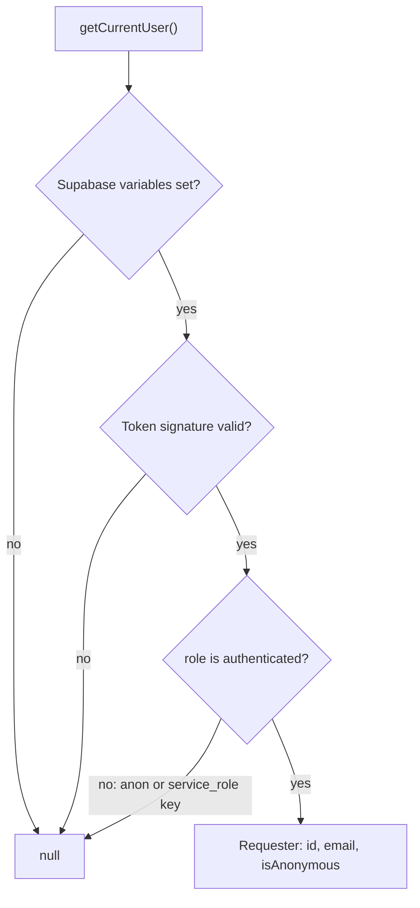
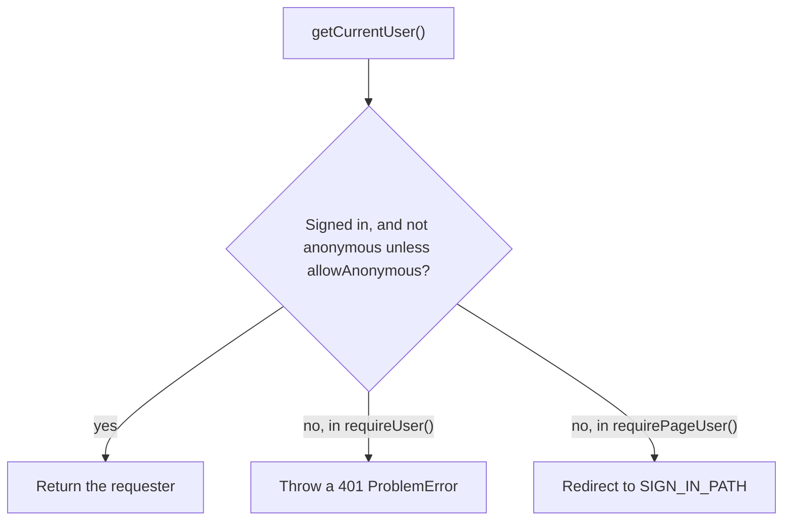
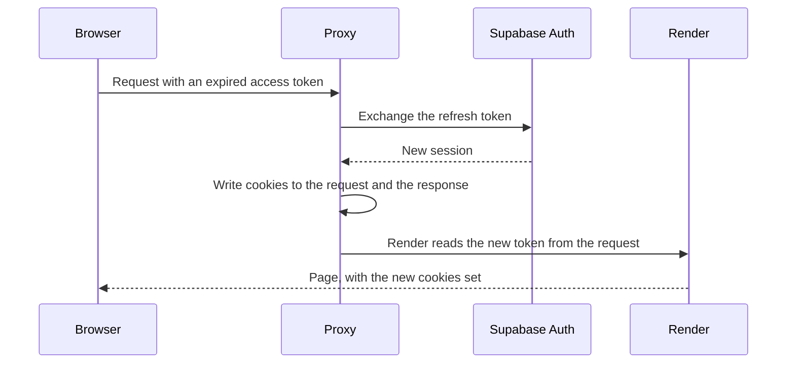

# Auth

How the server identifies the requester. Supabase Auth is optional: without its variables, nobody is signed in and the session refresh does nothing. Authorization (may this requester access this resource?) happens in the data access layer, not here; see [Data layer](data-layer.md).

## Identifying the requester

- Supabase `getClaims()` verifies the access token's signature against the project's keys. `getSession()` only reads the cookie, which anyone can forge, so it is never used for auth decisions.
- Project API keys are signed tokens too. The role check stops them from counting as a signed-in user.
- `getCurrentUser()` is wrapped in `React.cache`, so verification runs once per request however often it is called.
- When Supabase Auth does not answer within the time limit, the requester counts as not signed in, like any other failed verification. See [Time limit](#time-limit).

## Requiring a user

| Function | Used in | When not allowed |
| --- | --- | --- |
| `requireUser()` | Data access layer, Server Actions, Route Handlers | 401 Problem, through the [error handlers](errors.md) |
| `requirePageUser()` | Pages (Server Components) | Redirect to `SIGN_IN_PATH` (307) |

Supabase anonymous users hold a validly signed token but are rejected by default, because most features assume a real account.

No sign-in page exists yet. Add one at `SIGN_IN_PATH` (`/login` by default) before any page calls `requirePageUser()`. If it accepts a return address, it must accept only a same-origin relative path, or it becomes an open redirect.

## Refreshing an expired session

Server Components cannot write cookies, so they cannot refresh a token themselves. The proxy refreshes it before rendering.

- A revoked refresh token fails the exchange, and the requester is treated as signed out.
- The proxy never redirects on sign-in state. A changed proxy matcher could silently skip a route, so each page, action, and handler checks access itself.
- If the exchange does not finish within the time limit, the request goes on with the cookies it brought.
- The proxy, the server client, and the browser client write the session cookies with the same options (`SUPABASE_COOKIE_OPTIONS`): the library's defaults (path `/`, SameSite Lax, readable by script, since the browser client reads them), and in production builds also Secure, so the browser sends them only over HTTPS or to localhost. `pnpm dev` leaves them without Secure.
- The server and proxy clients are created per request and never stored globally. In the browser the library keeps one client and returns it on every call.
- Without the Supabase variables, creating a client throws a clear configuration error. Where the integration is optional, check `hasSupabaseEnvVars` from `@/config/env` first.

## Time limit

Supabase Auth answers on the request path: the proxy and `getCurrentUser()` may fetch the signing keys and exchange a refresh token. The SDK retries a failed exchange for up to 30 seconds, so a slow Auth server would hold every page that long.

- Each of the two gets 3 seconds per request (`AUTH_TIMEOUT_MS`), retries included. Past it, the calls in flight are aborted and the request goes on, as described above.
- Each time-out writes one warning line, so an outage shows up in the [server logs](logging.md).
- An exchange cut off after Supabase already issued a new session leaves the browser with the old refresh token. Supabase accepts a reused refresh token only for a short while, so a long outage can sign some users out.
- Only the clients used for auth get the limit, because it covers every call a client makes.

## Key files

| File | Role |
| --- | --- |
| `lib/auth.ts` | `getCurrentUser()`, `requireUser()`, `requirePageUser()`, `SIGN_IN_PATH` |
| `lib/supabase/proxy.ts` | Session refresh, called from `proxy.ts` |
| `lib/supabase/server.ts`, `lib/supabase/client.ts` | Server and browser clients |
| `lib/supabase/config.ts` | Supabase URL and key, with a clear error when unset, and the session cookie options every client uses |
| `lib/supabase/auth-deadline.ts` | The time limit for Supabase Auth calls |
| `test-utils/shared/supabase-auth.ts` | The fake Auth server tests use; see [Testing](testing.md) |

## Related rules

- [Security boundary](../AGENTS.md#security-boundary-client--server): identity, pages
