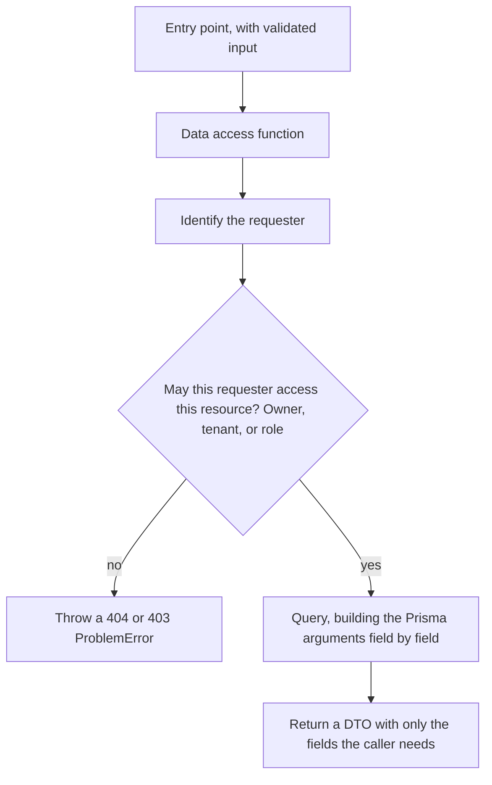
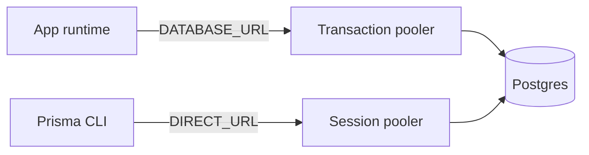

# Data layer

The data access layer (`data/`) is the only code that uses the database and Redis. Prisma connects as a role that bypasses RLS, so each function in it is where authorization actually happens.
No models, migrations, or data access functions exist yet; this page describes the shape they follow.

## A data access function

- The requester comes from `lib/auth.ts` (see [Auth](auth.md)) because anything the client sends can be forged.
- Arguments are built field by field and results are trimmed to a DTO, because whatever leaves the server reaches the browser.
- A page that gets a 404 or 403 `ProblemError` catches it and calls `notFound()`. No helper does this; uncaught, it shows the error page.
- The same steps apply when a function reads or writes Redis, such as a cache in front of a query, and one function may use both stores. A cached read authorizes after the read instead of before it; see [Redis](redis.md#redis-in-a-data-access-function).

## Connections

- The app connects through `lib/db.ts`, which holds the single Prisma Client. Every instance, a container or a serverless function, has its own pool of `DATABASE_POOL_MAX` connections (default 3, a whole number from 1 to 100), so concurrency grows with the number of instances rather than with the pool.
- The pooler counts every instance's connections against its client limit, which is why the [Commands](../AGENTS.md#commands) rule on multiple instances keeps instances times `DATABASE_POOL_MAX` within it. See [Multiple instances](delivery.md#multiple-instances).
- Idle connections close after five seconds, so a suspended instance does not hold them.
- The CLI connects through `prisma7.config.ts`, which reads `DIRECT_URL` straight from the environment so `prisma generate` still works in builds without it.
- The transaction pooler does not support named prepared statements; the adapter avoids them by default.
- Outside production the client lives on `globalThis`, so hot reloads do not pile up pools.
- The Prisma CLI loads only `.env`, so the database variables stay there, not in `.env.local`.

## Schema and migrations

- Models live in `prisma/models/<domain>.prisma`. All files merge into one schema, so relations cross files without imports.
- `pnpm install` generates the Prisma Client into `app/generated/prisma/` (git-ignored). Code imports it through the `@/prisma/*` alias: server types from `@/prisma/client`, and client-safe values such as enums and `Decimal` from `@/prisma/browser`.
- The test setup fails when the schema has a change that no migration covers, so a missing migration never reaches production.
- Production migrations are not part of the build. Apply them with `pnpm db:deploy`.

## Model conventions

The conventions are listed in [Database](../AGENTS.md#database); this table gives the reason for each.

| Topic | Why |
| --- | --- |
| Primary keys | UUID v7 cannot be guessed and sorts by creation time, which keeps indexes compact |
| Rows inserted outside Prisma | Prisma Client generates the ID, and a `gen_random_uuid()` default would produce UUID v4 and break the ordering. Supabase Postgres has no `uuidv7()` yet; once it does, a migration can switch the default to `dbgenerated("uuidv7()")` |
| Users | The `auth` schema belongs to Supabase and tests run on plain Postgres, so there is no foreign key; a deleted user's rows are cleaned up in app code. The fixed `userId` / `<role>UserId` names let the model check find these columns |
| Names | snake_case follows Postgres conventions |
| Time | Timestamps with time zone stay correct across time zones |
| Fractional values | `Decimal` is exact; `Float` is approximate, so the `///` comment on a `Float` field records why that is enough there |
| Foreign keys | Neither Postgres nor Prisma indexes them automatically; an index or unique key that starts with the column already serves lookups, so another one would only slow writes |

`prisma/models.vitest.test.ts` checks these conventions on every file in `prisma/models/`; with no files there yet, that per-file check has nothing to run on. It also checks that `prisma/schema.prisma` holds only the `generator` and `datasource` blocks, that files in `prisma/models/` hold only `model` and `enum` blocks, and that the three Prisma packages share one exact version. Prisma itself validates the syntax; the test catches what Prisma accepts but the rules do not. It always runs the checks against example schemas too, to show they accept a valid model and reject each broken model rule.

## Supabase project settings

Prisma creates tables in `public`, which the Supabase Data API serves to anyone holding the publishable key. Two project settings keep that surface closed:
- Keep "Automatically expose new tables" off, so new tables get no `anon` / `authenticated` grants.
- Turn on "Auto-enable RLS for new tables" as a second layer.

Prisma does not rely on those grants, so server code is unaffected. To expose a table on purpose, create an empty migration with `pnpm db:migrate --create-only` and add its grants and policies to the SQL.

## Key files

| File | Role |
| --- | --- |
| `data/` | Data access functions |
| `lib/db.ts` | Prisma Client and connection pool |
| `prisma/schema.prisma`, `prisma/models/` | Schema |
| `prisma/models.vitest.test.ts` | The model convention check |
| `prisma/migrations/` | Migrations, created by the first `pnpm db:migrate` |
| `prisma7.config.ts` | Prisma CLI config |
| `config/env.server.ts` | `DATABASE_URL`, `DATABASE_POOL_MAX` |

## Related rules

- [Security boundary](../AGENTS.md#security-boundary-client--server): data access layer, identity, return values, mass assignment
- [Database](../AGENTS.md#database): models, migrations, Data API exposure, primary keys, users, conventions
- [Redis](../AGENTS.md#redis): Redis through the data access layer, with the same checks as the database
- [Commands](../AGENTS.md#commands): multiple instances, for the pool size
