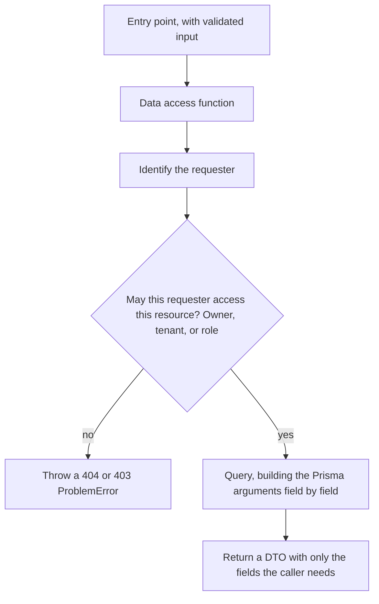
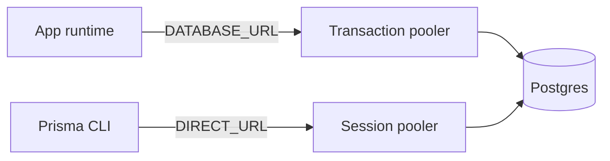

# Data layer

The data access layer (`data/`) is the only code that queries the database. Prisma connects as a role that bypasses RLS, so each function in it is where authorization actually happens.
No models, migrations, or data access functions exist yet; this page describes the shape they follow.

## A data access function

- The requester comes from `lib/auth.ts` (see [Auth](auth.md)) because anything the client sends can be forged.
- Arguments are built field by field and results are trimmed to a DTO, because whatever leaves the server reaches the browser.
- A page that gets a 404 or 403 `ProblemError` catches it and calls `notFound()`. No helper does this; uncaught, it shows the error page.

## Connections

- The app connects through `lib/db.ts`, which holds the single Prisma Client. Each serverless instance keeps a small pool, and idle connections close quickly.
- The CLI connects through `prisma7.config.ts`, which reads `DIRECT_URL` straight from the environment so `prisma generate` still works in builds without it.
- The transaction pooler does not support named prepared statements; the adapter avoids them by default.
- Outside production the client lives on `globalThis`, so hot reloads do not pile up pools.
- The Prisma CLI loads only `.env`, so the database variables stay there, not in `.env.local`.

## Schema and migrations

- Models live in `prisma/models/<domain>.prisma`. All files merge into one schema, so relations cross files without imports.
- `pnpm install` generates the Prisma Client into `app/generated/prisma/` (git-ignored). Code imports it through the `@/prisma/*` alias: server types from `@/prisma/client`, and client-safe values such as enums and `Decimal` from `@/prisma/browser`.
- The test setup fails when the schema has a change that no migration covers, so a missing migration never reaches production.
- Production migrations are not part of the build. Apply them with `pnpm db:deploy`.

## Model conventions

The conventions are listed in [Database](../AGENTS.md#database); this table gives the reason for each.

| Topic | Why |
| --- | --- |
| Primary keys | UUID v7 cannot be guessed and sorts by creation time, which keeps indexes compact |
| Rows inserted outside Prisma | Prisma Client generates the ID, and a `gen_random_uuid()` default would produce UUID v4 and break the ordering. Supabase Postgres has no `uuidv7()` yet; once it does, a migration can switch the default to `dbgenerated("uuidv7()")` |
| Users | The `auth` schema belongs to Supabase and tests run on plain Postgres, so there is no foreign key; a deleted user's rows are cleaned up in app code |
| Names | snake_case follows Postgres conventions |
| Time | Timestamps with time zone stay correct across time zones |
| Money | `Decimal` is exact; `Float` is not |
| Foreign keys | Neither Postgres nor Prisma indexes them automatically |

## Supabase project settings

Prisma creates tables in `public`, which the Supabase Data API serves to anyone holding the publishable key. Two project settings keep that surface closed:
- Keep "Automatically expose new tables" off, so new tables get no `anon` / `authenticated` grants.
- Turn on "Auto-enable RLS for new tables" as a second layer.

Prisma does not rely on those grants, so server code is unaffected. To expose a table on purpose, create an empty migration with `pnpm db:migrate --create-only` and add its grants and policies to the SQL.

## Key files

| File | Role |
| --- | --- |
| `data/` | Data access functions |
| `lib/db.ts` | Prisma Client and connection pool |
| `prisma/schema.prisma`, `prisma/models/` | Schema |
| `prisma/migrations/` | Migrations, created by the first `pnpm db:migrate` |
| `prisma7.config.ts` | Prisma CLI config |
| `config/env.server.ts` | `DATABASE_URL` |

## Related rules

- [Security boundary](../AGENTS.md#security-boundary-client--server): data access layer, identity, return values, mass assignment
- [Database](../AGENTS.md#database): models, migrations, Data API exposure, primary keys, users, conventions
