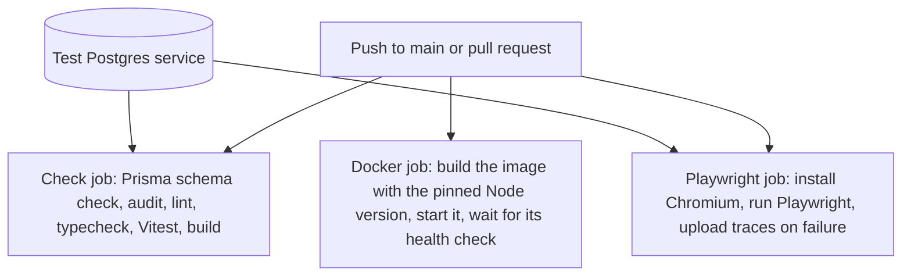
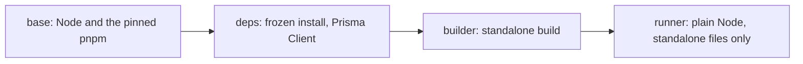
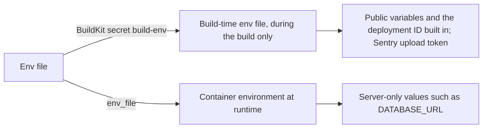

# Delivery

What CI checks, how dependencies are updated, how environment variables are read, how the production image is built, how variables reach the build and the running app, and what running several instances takes.

## CI

`.github/workflows/ci.yml` runs on every push to `main` and every pull request, with read-only permissions and no secrets. The shared setup takes pnpm from `packageManager` and Node from `.nvmrc`, then installs from the frozen lockfile. `.gitattributes` checks out every text file with LF line endings, whatever the machine's Git settings, so CI, the image build, and local runs read the same files.

- The Docker job starts the image it built, with no environment, and asks `/api/health` up to 30 times, one second apart, giving each request at most 2 seconds. If none succeeds, it prints the container's logs and fails
- CI never reaches the Supabase project or its database. Whether production has every variable is a deployment concern, not a CI one.
- Make the jobs required checks in branch protection, so the server boundary and its tests cannot be merged around.
- `pnpm build` type-checks app code only (`tsconfig.build.json`), so changes to tests or the docs tooling never break a deploy. `pnpm typecheck` covers everything.
- `pnpm build` downloads the Noto Sans fallback font (loaded in `app/layout.tsx`) from the font service behind `next/font/google`, so every build, in CI and in the Docker image, needs outbound network access. The build bundles the files into `/_next/static/media/`, and the app serves them from this origin, so the browser never contacts that service.
- Supply chain:
  - pnpm installs only versions at least 7 days old.
  - `pnpm audit` fails on high or critical advisories.
  - Only allowlisted packages may run install scripts (`allowBuilds`).

## Dependency updates

Dependencies move only as the [Commands](../AGENTS.md#commands) rules allow, because every update can bring changes nobody asked for.

- Dependabot alerts and security updates are turned on in the repository settings, with no file in the repository; there are no scheduled version updates. A fix younger than 7 days goes into `minimumReleaseAgeExclude`, as those rules allow.
- The quarterly support check is there because security fixes usually land only on the newest major, so falling far behind turns a later fix into a major upgrade.

Some packages must match each other, so they move in one update:

| Packages | Why they match |
| --- | --- |
| `prisma`, `@prisma/client`, `@prisma/adapter-pg` | The CLI that generates the client and the runtime it runs on must be one release; `prisma/models.vitest.test.ts` checks the one exact version |
| `react`, `react-dom`, `@types/react`, `@types/react-dom` | React and its renderer must share one version, and the types describe that version |
| `pg`, `@types/pg` | `@prisma/adapter-pg` runs on the app's `pg`, and the types describe that version |
| `@tanstack/react-query`, `@tanstack/react-query-devtools` | The devtools require the matching version of the query package |

## Environment variables

- `config/env.ts` (public) and `config/env.server.ts` (server-only) parse the variables with zod when the module loads, so a bad value fails at start-up, not deep in a request.
- An empty value (`FOO=`) counts as unset, so optional integrations stay off until they are filled in.
- Next.js replaces each `NEXT_PUBLIC_*` with its value at build time. Each one is written out in full in `config/env.ts`, and values derived from them, such as whether Supabase is on or the showcase is open, are fixed per build.
- `.env.example` lists every variable with its purpose.

## Docker image

- Standalone output is switched on inside the image only (`NEXT_OUTPUT_STANDALONE=1`).
- The runner starts from plain Node, so pnpm, sources, and `package.json` stay out.
- It runs as the unprivileged `node` user, with a health check on `/api/health`.
- `.dockerignore` keeps `.env`, `node_modules`, build output, and test results out of the build context.
- The image never runs migrations. Pushing and deploying the image are not set up yet.

## Variables at build and run time

Variables are never listed one by one in `Dockerfile` or Compose, so adding one never touches those files. A variable app code reads goes in `.env.example`, the zod schema, and the README table; one Next.js reads itself, such as `NEXT_DEPLOYMENT_ID`, has no schema entry (see the last point below).

- Compose passes `.env` both as the secret and as `env_file`. The secret is mounted as `.env.production.local` while `pnpm build` runs.
- A secret mount never lands in an image layer, and Next.js does not copy `.env.production.local` into the standalone output.
- Building without the secret, as CI does, produces an image with every optional variable unset.
- Server-only values stay out of the image and can change without a rebuild.
- `NEXT_DEPLOYMENT_ID` and `NEXT_SERVER_ACTIONS_ENCRYPTION_KEY` are read by Next.js itself during `next build`, not by app code. Next.js loads the env files first, so setting them in `build-env` is enough.

## Compose

| Use | Command | Notes |
| --- | --- | --- |
| Development database | `pnpm docker:db` | Listens on `127.0.0.1:5432` only; data persists in the `db-data` volume. Point `.env` at it as in `.env.example`, create the schema with `pnpm db:migrate`, and run the app on the host with `pnpm dev` |
| Production image as a service | `pnpm docker:up` | Listens on `127.0.0.1:3000` only. Needs `.env`. Reads `DATABASE_URL` unchanged, so it must be reachable from inside a container; `localhost` there is the container itself. Apply migrations first with `pnpm db:deploy`. Stopping it allows 30 seconds (`stop_grace_period`) before the container is killed |
| Test database | `pnpm test:db:up` / `test:db:down` | Port 5433, in-memory data, its own Compose project |

The development project is named after the folder and the test project after `name` in `package.json`, so separate projects never share containers or volumes.

## Multiple instances

The app can run as several instances behind a load balancer without any extra service. What each deployment must do is in the [Commands](../AGENTS.md#commands) rule on multiple instances; this table gives how each part works and why.

| Concern | How it works | Why |
| --- | --- | --- |
| Deployment ID | `NEXT_DEPLOYMENT_ID` in `build-env`, one value per deployment such as the commit SHA, the same on every instance. Next.js adds it to asset URLs and navigation headers | During a rolling deployment, a client that reaches an instance of another deployment does a full reload instead of mixing versions. Next.js does not route by it; keeping a client on one deployment is up to the host |
| Server Action key | Next.js generates a new key per build and builds it in, so instances started from one image already share it. `NEXT_SERVER_ACTIONS_ENCRYPTION_KEY` in `build-env` is needed only when instances run separate builds of the same version | The key salts each action's ID and encrypts the values an action closes over, so a build with another key neither finds nor decrypts the actions of this one |
| Database connections | Every instance has its own pool of `DATABASE_POOL_MAX` connections | The pooler counts all of them against its client limit; see [Connections](data-layer.md#connections) |
| Shutdown | The standalone server handles SIGTERM and SIGINT itself: it closes the server, lets in-flight requests and pending `after()` callbacks finish, then exits. Compose gives the app container 30 seconds | A platform that kills the process sooner loses that work, such as [notifications](notifications.md) still being sent |
| Shared state | Nothing instances must share lives in process memory. There is no rate limiting yet, and pages render dynamically for the per-request CSP nonce, so there is no page cache to keep in step | There is no shared store or shared cache handler. The [rate limiting](../AGENTS.md#security-boundary-client--server) rule needs a shared store once the first limit is added; a cache handler is the Next.js extension point if cached pages are added |

## Key files

| File | Role |
| --- | --- |
| `.github/workflows/ci.yml`, `.github/actions/setup/` | CI jobs and shared setup |
| `pnpm-workspace.yaml` | Release age rule, its exceptions, install-script allowlist |
| `config/env.ts`, `config/env.server.ts`, `.env.example` | Environment variables |
| `tsconfig.json`, `tsconfig.build.json` | Type-check scopes |
| `package.json` | Dependencies, scripts, `packageManager`, `engines` |
| `Dockerfile`, `.dockerignore` | Production image |
| `docker-compose.yaml`, `docker-compose.test.yaml` | Development, service, and test containers |
| `.nvmrc` | Node version |
| `app/layout.tsx` | Fonts the build downloads (`next/font/google`) |
| `.gitattributes` | LF line endings for every text file |

## Related rules

- [Commands](../AGENTS.md#commands): pnpm, release age, dependency updates, verification, Node pinning, CI and Docker files, multiple instances
- [Environment variables](../AGENTS.md#environment-variables): the env modules and their build-time exceptions, public variables, `.env.example`
