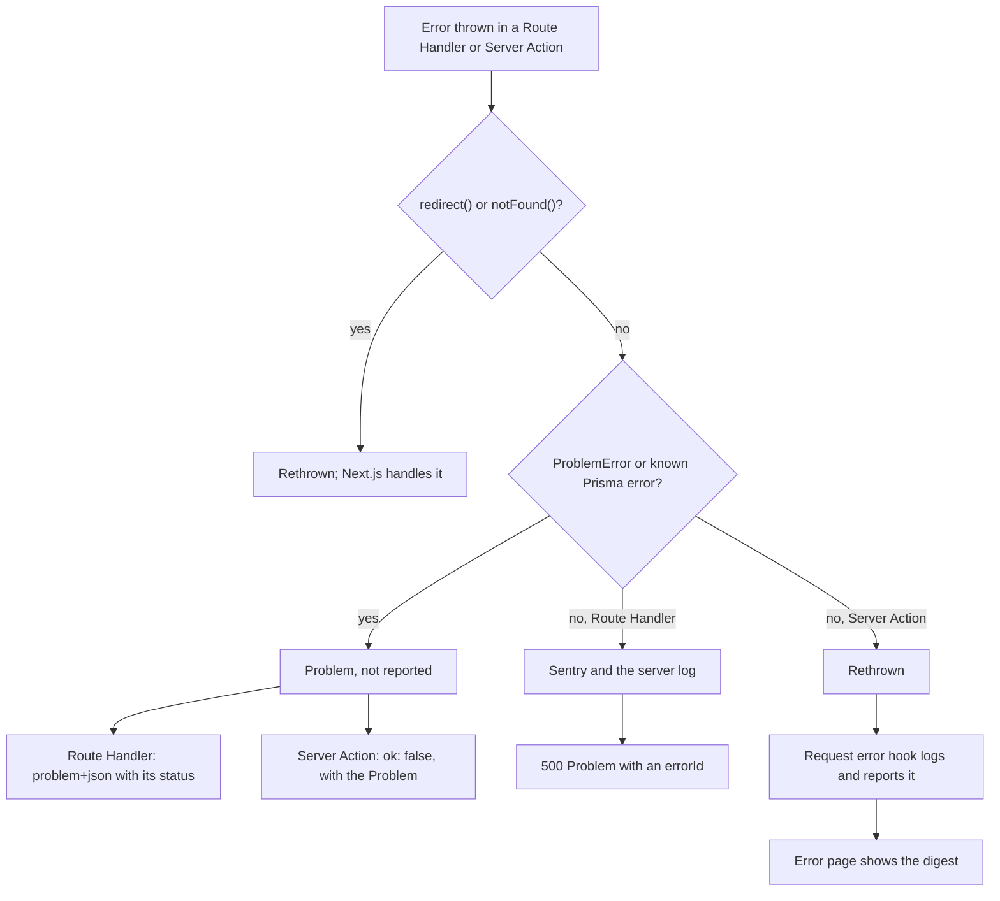

# Errors

Failures follow [RFC 9457 Problem Details](https://www.rfc-editor.org/rfc/rfc9457). A Route Handler answers with an `application/problem+json` response. A Server Action returns the same Problem inside `ActionResult`, and lets unexpected errors reach the error page.

## From a thrown error to a response

One mapping (`lib/server/error-mapper.ts`) decides which Problem an error becomes, so every entry point answers the same failure the same way. The error handlers only send the Problem out in the shape each entry point needs; they do not authenticate or validate input. Known Prisma errors are a unique violation (409) and a missing record (404). The mapping reads only an error's class and `code`, which stay when `lib/db.ts` removes query values from Prisma errors (see [Data layer](data-layer.md#prisma-errors-without-query-values)).

Client input fails as a 400 `validation-failed` `ProblemError`, which the input validation (`lib/server/validation.ts`) builds with `mapValidationError()`. The mapping does not map a raw zod error: client input goes through the input validation, so it never reaches the mapping as one, and a raw zod error comes from the server's own data, such as a stored value or an outside service's response, and is a bug. It takes the unexpected path, so it is reported, and a Route Handler answers 500 with no field details that would point into internal shapes.

## The Problem

| Member | Meaning |
| --- | --- |
| `type` | The kind of failure, and the only member clients branch on. `about:blank` when the status says everything |
| `title` | Short summary, fixed per `type` |
| `status` | HTTP status code |
| `detail` | This occurrence, shown to the user |
| `instance` | The request path (Route Handlers only) |
| `errors` | Validation failures: `pointer` (JSON Pointer into the input) and `detail` |
| extension members | Extra values a domain chose to expose |

Every `type` URI other than `about:blank` starts with `PROBLEM_TYPE_BASE` (`/problems/`) in `lib/problem.ts`. Clients compare `type` values, so a type is an identifier, the same in every environment; that is why the [Observability](../AGENTS.md#observability) rules keep a released type's name. It is a relative URI reference, which RFC 9457 allows, so it carries no host that differs between environments or must be set per service.

| Situation | Status | `type` |
| --- | --- | --- |
| Input fails its zod schema in the input validation | 400 | `validation-failed`, with `errors` |
| Body that is not JSON | 400 | `about:blank` |
| Not signed in / not allowed | 401 / 403 | `about:blank` or a domain type |
| Target not found | 404 | `about:blank` or a domain type |
| Conflict with the current state | 409 | `about:blank` or a domain type |
| Valid input that breaks a business rule | 422 | domain type |
| Rate limit exceeded | 429 | `about:blank` or a domain type |
| Anything else | 500 | `about:blank` with a generic message |

## Server pieces

| Piece | Location | Role |
| --- | --- | --- |
| `ProblemError` | `lib/problem.ts` | Thrown for expected failures, with a status number or a domain problem type |
| `defineProblemType()` | `lib/problem.ts` | Declares a domain type in `domains/<domain>/`, which imports no server-only module so the client can compare `type`. Throws on a name that is not kebab-case |
| `withRouteErrorHandler()` | `lib/server/error-handlers.ts` | Wraps a Route Handler |
| `withActionErrorHandler()` | `lib/server/error-handlers.ts` | Wraps a Server Action, exported as-is from the `"use server"` file, and returns `ActionResult` |
| `loadForPage()` | `lib/server/error-handlers.ts` | Runs one `data/` call in a Server Component: a 404 or 403 becomes `notFound()`, a 401 redirects to `SIGN_IN_PATH`, and anything else is rethrown |
| `parseJson()`, `parseSearchParams()`, `parseFormData()`, `parseInput()` | `lib/server/validation.ts` | Validate input and throw a 400 validation Problem |
| `parseParams()`, `parsePageParams()` | `lib/server/validation.ts` | Validate route params; an invalid param means not found |

ESLint checks the wrapping, so no Server Action or Route Handler skips the mapping ([Server endpoints](../AGENTS.md#server-endpoints); [Architecture](architecture.md#serverclient-boundary) for what lint checks).

Pages have no wrapper, so `loadForPage()` is their counterpart, called around each `data/` call ([Security boundary](../AGENTS.md#security-boundary-client--server), pages). Without it, each page would need its own `try`/`catch`, and a forgotten one would turn an expected 404 into an unexpected error: the error page, and a report to Sentry. A 403 shows the not-found page like a 404, so a forbidden resource looks missing. Any other failure, expected or not, still reaches `error.tsx` and `onRequestError`. Nothing checks that a page uses it, and no page does yet.

## Client error handling

- `lib/ky.ts` turns a failed response's Problem `detail` (or `title`) into the error message, and `getProblem()` returns the Problem itself for branching on `type` or showing `errors` on form fields.
- `lib/ky.ts` defaults to `retry: 0` and retries only when a call asks, so a failed request reaches the caller at once; [Data fetching](../AGENTS.md#data-fetching) says who sets the retry policy. Requests send cookies to this origin only.
- A form reads `ActionResult`: `ok: true` carries the data, and `ok: false` carries the Problem. A thrown error's message never reaches the client.

## What reaches Sentry and the server log

| Where the error happens | Logged and reported by | What the client gets |
| --- | --- | --- |
| Server Component, proxy, unexpected Server Action error | `onRequestError` (`lib/server/request-errors.ts`) | Error page with the digest |
| Route Handler, unexpected error | The error mapping | 500 Problem whose `errorId` is the Sentry event ID |
| Route Handler or Server Action, expected failure | Neither | The Problem |
| Page, expected failure other than 401, 403, or 404 | `onRequestError`, because `loadForPage()` rethrows it | Error page with the digest |
| Browser | The browser SDK, plus the error pages for errors without a digest; no server log | Error page |

- Route Handler errors never reach `onRequestError`, because the error handler catches them first. That is why two server paths exist.
- Without `NEXT_PUBLIC_SENTRY_DSN`, Sentry is not initialized and nothing is sent; the server log still records every unexpected error.
- Every unexpected error also becomes one structured log line; [Logging](logging.md) covers its fields, the request ID, and how a deployment collects it.
- Outside development, a Prisma error reaches the log and Sentry without the query's values; see [Data layer](data-layer.md#prisma-errors-without-query-values).
- Data collection is minimal (`lib/sentry/options.ts`): no user info, cookies, headers, bodies, or query parameters. Performance traces are only sampled.
- On the server (Node and Edge), outgoing requests to the notification webhook get no span or breadcrumb (`lib/sentry/server.ts`), because the SDK records a request's URL path and the webhook's secret is in its path.
- With the `SENTRY_*` build variables, the build uploads source maps and then deletes them from the output, so they are never public.
- `GET /api/health` answers `{"status":"ok"}` with `Cache-Control: no-store`, without touching the database or any other service. It is public, so it stays that cheap; dependency checks go behind a protected route.

## Key files

| File | Role |
| --- | --- |
| `lib/problem.ts` | Problem contract, `ProblemError`, `ActionResult` |
| `domains/` | Domain problem types, one folder per domain |
| `lib/server/error-mapper.ts` | Error to Problem, and the log and Sentry for Route Handlers |
| `lib/server/request-errors.ts` | `onRequestError`: the log and Sentry for other server errors |
| `lib/server/error-handlers.ts` | Route Handler and Server Action wrappers, and `loadForPage()` for pages |
| `lib/server/validation.ts` | Input and route param validation |
| `lib/ky.ts` | Client-side Problem handling |
| `instrumentation.ts`, `instrumentation-client.ts`, `lib/sentry/` | Sentry setup |
| `app/api/health/route.ts` | Health check |

## Related rules

- [Server endpoints](../AGENTS.md#server-endpoints): error handlers, error mapping
- [Security boundary](../AGENTS.md#security-boundary-client--server): `loadForPage()` around each `data/` call in a page
- [Observability](../AGENTS.md#observability): Sentry, server logs, health check, validation, Problems, status rules, released problem types
- [Data fetching](../AGENTS.md#data-fetching): the HTTP client, the retry policy
