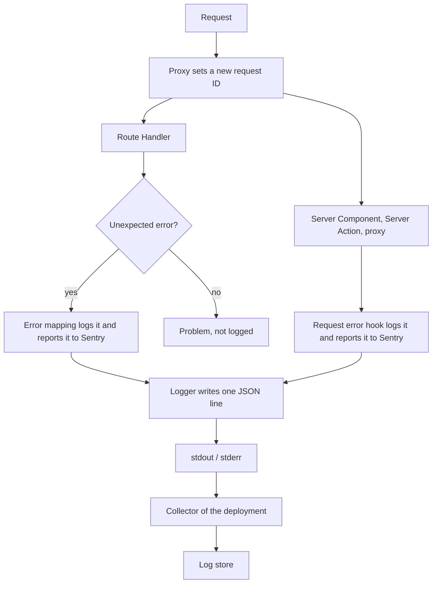

# Logging

How the server writes its logs and how a deployment collects them. The app only prints structured lines; collecting, storing, and searching them belong to the deployment.

## From an error to a log line

- Only unexpected errors are logged, each exactly once. Expected failures are Problems the client already receives, so logging them would only add noise.
- One warning comes from outside this flow: a Supabase Auth call that runs past its time limit (see [Auth](auth.md#time-limit)), with `code.function.name` and `supabase.auth.timeout_ms`.
- Route Handler errors never reach the request error hook, because the error handler catches them first; that is why two paths write the same kind of line.
- The app never sends lines to a log store itself, so a slow or missing store cannot slow a request, and changing stores needs no code change.

## The log line

Each line is one JSON object. Field names follow the OpenTelemetry log data model and semantic conventions, so collectors map them without per-field rules.

| Field | Meaning |
| --- | --- |
| `timestamp`, `severity_text`, `body` | Time (UTC), level (`INFO`, `WARN`, `ERROR`), and a fixed message |
| `service.name` | `SERVICE_NAME`, or `name` in `package.json` when it is empty |
| `deployment.environment.name` | `APP_ENV`, or `NODE_ENV` when it is empty |
| `request.id` | The request ID the proxy set |
| `http.request.method`, `url.path` | The request, without its query string |
| `next.route_type`, `next.route_path` | The kind of server code that failed and its route pattern (request error hook only) |
| `exception.type`, `exception.message`, `exception.stacktrace` | The error, with up to three causes; the stack trace is cut at 16,000 characters |
| `sentry.event_id` | The Sentry event, equal to the `errorId` in the 500 Problem (Route Handlers only) |
| `next.digest` | The code shown on the error page |

- The first five fields are always present, and attributes cannot overwrite them.
- `body` stays the same for every line of a kind, so a log store can group and count them; changing values go into attributes.
- Set `APP_ENV` per deployment when several deployments share one `NODE_ENV`, for example a preview and production.

## Tying a report to its line

| What the user sees | Field to search |
| --- | --- |
| `errorId` in a 500 Problem | `sentry.event_id` |
| Digest on the error page | `next.digest` |

The request ID ties together every line of one request. The proxy replaces any `x-request-id` the client sends, so a client cannot inject or reuse an ID, and the ID is never sent back in the response.

## What never reaches the log

- Request bodies, headers, cookies, tokens, query strings, and personal data are never passed to the logger.
- As a backstop, attributes whose key looks secret or personal (token, cookie, session, password, email, API key) are written as `[REDACTED]`, at any depth.
- Circular values, very deep objects, and values that cannot be serialized never make logging throw; the logger falls back to the plain message.

## Collecting the logs

Next.js also prints its own, unstructured lines for the same errors, so a collector keeps lines that are not JSON as plain text.

| Log store | How the lines get there |
| --- | --- |
| The deployment's log store | A collector or log driver that reads stdout and stderr and parses each line as JSON. Label or index only `service.name`, `deployment.environment.name`, and `severity_text`, and read the other fields from the JSON |
| Sentry | Errors only, through the SDK. Sentry Logs is not enabled |

## Trying it locally

The pages in `app/playwright/` are built only for Playwright, some of them to fail on purpose, and exist only in builds run with `PLAYWRIGHT=1`. Opening the server error page, or submitting the Server Action error page, prints a log line in the terminal running the server. Such a build contains those pages, so rebuild without the variable before deploying.

## Key files

| File | Role |
| --- | --- |
| `lib/server/logger.ts` | The logger: line format, fixed fields, redaction, exceptions |
| `lib/server/error-mapper.ts` | Logs unexpected Route Handler errors |
| `lib/server/request-errors.ts` | `onRequestError`: logs other server errors |
| `lib/server/error-handlers.ts` | Passes the method and request ID to the error mapping |
| `proxy.ts` | Sets the request ID |
| `lib/supabase/auth-deadline.ts` | Logs a Supabase Auth time-out |
| `config/env.server.ts` | `SERVICE_NAME` and `APP_ENV` |
| `test-utils/vitest/setup.ts` | `loggedErrors()` and `loggedWarnings()` read the lines a test printed |

## Related rules

- [Observability](../AGENTS.md#observability): the logger, what never to log, Sentry
- [Environment variables](../AGENTS.md#environment-variables): server-only variables
- [Server endpoints](../AGENTS.md#server-endpoints): error handlers, error mapping
