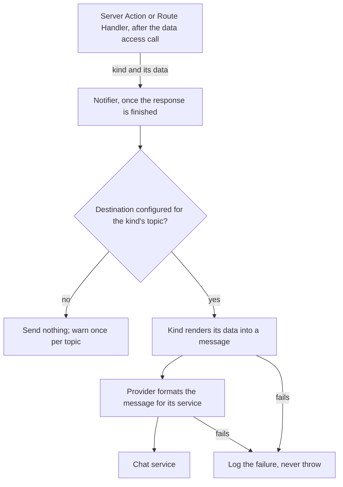

# Notifications

How server code posts notifications to a chat service: notices about running the service, and notifications about requests in a business domain. Unexpected errors are not notifications: Sentry already reports them (see [Errors](errors.md)).

## From the caller to the chat service

Code that sends names a kind of notification and passes its data; it never names a service or channel. The kind picks the topic, and the topic picks the provider, so a new service or destination needs no change where notifications are sent.

- `notify(kind, data)` hands the send to Next.js `after()`, which runs it once the response is finished, so a slow or failing chat service never delays or fails the request.
- `sendNotification(kind, data)` sends now and resolves to whether the service accepted the notification. It is for code with no request to wait for, such as a script. Lint rejects it in every linted file outside `lib/notify/`, `test-utils/`, and tests (below), so a script that needs it gets its own exemption in `eslint.config.mjs`.
- Neither throws. A notification is a side effect of the work that caused it, so its failure must not fail that work; it is logged instead.
- Delivery is best effort: a failed send is not retried later, and a restart before the response finishes loses the notification. There is no durable outbox, which is why the [Notifications](../AGENTS.md#notifications) rules keep anything that must not be lost out of it.
- An endpoint that notifies on every call can flood the channel, so it falls under [rate limiting](../AGENTS.md#security-boundary-client--server).
- Only entry points know whether their `data/` call succeeded, so ESLint (`notify/call-sites`) lets app code reach the notify module in one way only: `import { notify }`, in a file that starts with `"use server"` or a Route Handler file.
- Every other way in is rejected in every app file, entry points included: a namespace or default import, a dynamic `import()` or `require()` with a string or template literal, a re-export from the module, and importing `sendNotification()`.
- The module's own files (`notifier.ts`, `providers/`, `kind.ts`, any `/notify/<file>` but `index`, aliased or relative) give only types, through an `import type` or a type-only re-export, in every app file, entry points included, so no code builds a sender of its own around the notifier or a provider.
- `defineNotification()` and the types import anywhere from `@/lib/notify`. `lib/notify/`, `test-utils/`, and test files are exempt.
- The module is matched by the end of its path (`/notify` or `/notify/index`), aliased or relative, so a relative `./notify` from `lib/` is caught too.
- Left to review: whether `notify()` runs after the `data/` call succeeds.
- The check is the built-in syntax restriction registered under its own name, because the boundary lint blocks set that rule per folder, and a later block would replace or turn off the selectors.

## Kinds of notification

A kind is defined once with `defineNotification(name, { topic, render })`, so each message is formatted in one place, however many callers send it.

| Part | Meaning |
| --- | --- |
| Name | Fixed kebab-case identifier; logs and tests match on it, so it never changes once released |
| Topic | Kebab-case name of where the kind goes, such as `ops`; it names a destination, never a service or channel |
| `render` | Turns the kind's data into a message |

- Each kind lives in its own file in `notifications/`, as the [Notifications](../AGENTS.md#notifications) rules set out, so a test can find and check every kind. The folder holds no kinds yet.
- `lib/notify/notification-files.vitest.test.ts` checks each file there: a kebab-case file name, `import "server-only"` first, exactly one exported kind, a kind name equal to the file name, and the PascalCase export. It also checks the same rules on sample sources, the only checks that run while the folder holds no kinds.
- `defineNotification()` throws when the name or topic is not kebab-case, so a bad kind fails when its module loads.
- Each field of a kind's data (`NotificationData`) is a string, number, boolean, null, or undefined (an optional field), or a list of strings, numbers, or booleans, with no null in a list. The type checker rejects any other field, such as a `Date`, a `Decimal`, a relation, or a nested object, so callers convert such values first. A record whose fields are all primitives still passes, so keeping Prisma records out is left to the [Notifications](../AGENTS.md#notifications) rules, not the type checker.

## Topics and destinations

- Every topic goes to one default destination for now: the incoming webhook in `NOTIFY_SLACK_WEBHOOK_URL`.
- With no destination configured, nothing is sent and a warning is logged once per topic, so development and tests need no chat service.
- Routing a topic elsewhere means adding a server variable for the new destination and returning its provider for that topic in `lib/notify/index.ts`. Adding a service means adding a provider in `lib/notify/providers/`. Code that sends changes in neither case.
- The webhook URL is a secret, since anyone holding it can post to the channel. It must be an `https` URL; any other value fails at start-up.

## The message

A message belongs to no chat service. Each provider turns it into its own format, so the code that sends one never depends on the service that delivers it.

| Member | Meaning |
| --- | --- |
| `title` | Short plain-text headline |
| `text` | Body, treated as plain text |
| `level` | `info` (the default), `warning`, or `critical`; the provider marks the headline with it |
| `fields` | Label and value pairs shown below the text; a provider may show only the first few |
| `link` | An `http` or `https` link to the resource, with an optional label; any other URL is dropped, and a provider may also drop a URL too long for its service |

A provider implements `NotifyProvider`: a service name for logs, and a `send()` that receives the message with the kind's name and topic, so it can format one kind its own way, and throws when the service does not accept it. Everything in a message leaves the app, which is why the [Notifications](../AGENTS.md#notifications) rules limit what it may carry.

## The chat service provider

The one provider so far, `lib/notify/providers/slack.ts`, posts to one channel through an incoming webhook.

- It escapes the characters the service reads as markup, so text in a message cannot mention anyone or hide a link behind a label.
- It cuts text to the service's block limits, drops fields past the limit, and drops a link whose URL is longer than 3000 characters, instead of having the whole message rejected. Cutting never splits an escape sequence.
- Each attempt times out after 3 seconds. A 429 is retried once, after the time `Retry-After` asks for, capped at 5 seconds; any other failure throws for the notifier to log.
- It posts through the project's HTTP client (`lib/ky.ts`), which defaults to `retry: 0` and retries only when a call asks, so that one retry is the provider's own, set on its call as [Data fetching](../AGENTS.md#data-fetching) requires.
- `lib/notify/providers/format.ts` holds the checks a new provider can share: truncation, escaping within a length limit, and the `http(s)` link check.

## Notification log lines

| Line | Level | Attributes |
| --- | --- | --- |
| `Notification failed` | error | `notify.kind`, `notify.topic`, `error.type` (the HTTP status, `timeout`, or the error name); `notify.provider` once a provider was found, and `http.response.status_code` when the service answered |
| `Notification skipped: no destination configured` | warn | `notify.kind`, `notify.topic`; once per topic |

The error message is never logged, because it can carry the webhook URL. As a backstop, the logger also redacts any attribute whose key contains `webhook` (see [Logging](logging.md#what-never-reaches-the-log)). Sentry records no span or breadcrumb for requests to the webhook either (see [Errors](errors.md#what-reaches-sentry-and-the-server-log)).

## Notifications in tests

Vitest mocks `@/lib/notify` for every test, so no test reaches a chat service. Kinds are still defined for real, so modules that define one load as in production. `sentNotifications()` returns the kind name and data of each `notify()` call in the current test; the mocked `sendNotification()` resolves to `true` and is not recorded there. The tests of `lib/notify` itself import its modules directly and stub `fetch`. See [Testing](testing.md).

## Key files

| File | Role |
| --- | --- |
| `notifications/` | Kinds of notification, one file each; none yet |
| `lib/notify/index.ts` | `notify()`, `sendNotification()`, and the provider each topic gets |
| `lib/notify/kind.ts` | `defineNotification()` |
| `lib/notify/types.ts` | The message, `NotificationKind`, `NotificationData`, and the `NotifyProvider` interface |
| `lib/notify/notifier.ts` | Resolves the provider per topic, renders, sends, never throws, logs failures and skips |
| `lib/notify/providers/slack.ts` | The chat service provider: message format, escaping, limits, retry |
| `lib/notify/providers/format.ts` | Truncation, escaping, and the link check shared by providers |
| `lib/notify/notification-files.vitest.test.ts` | Checks the files in `notifications/` |
| `config/env.server.ts` | `NOTIFY_SLACK_WEBHOOK_URL`, the default destination |
| `eslint.config.mjs` | Where `notify()` may be imported, and what else may be imported from the module |
| `test-utils/vitest/setup.ts` | The global mock and `sentNotifications()` |

## Related rules

- [Notifications](../AGENTS.md#notifications): `notify()` only, kinds and their files, flat data, best effort, what never goes in a notification, no notifications for unexpected errors, providers and destinations
- [Security boundary](../AGENTS.md#security-boundary-client--server): rate limiting endpoints that post a notification
- [Observability](../AGENTS.md#observability): the logger, what never to log
- [Data fetching](../AGENTS.md#data-fetching): the HTTP client, the provider's own retry
- [Environment variables](../AGENTS.md#environment-variables): server-only variables, `.env.example`
- [Commands](../AGENTS.md#commands): the global Vitest mocks
