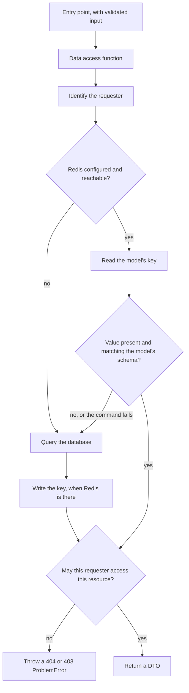

# Redis

The optional Redis infrastructure: the client, Redis models, and how the data access layer (`data/`) uses them. Redis is the app's cache, where nothing is permanent, and the app runs the same without `REDIS_URL`.
Nothing uses Redis yet: no `data/` function calls it and `redis/models/` holds no models. This page describes the shape the first uses follow.

## Redis as a cache

The [Redis](../AGENTS.md#redis) rules treat any key as one that can disappear at any time, which is what lets Redis make room for new writes by dropping old keys.

- The Compose Redis, for development and tests, runs with a memory limit and `maxmemory-policy allkeys-lru`, CI gives its Redis the same settings as the test Redis (see [CI](delivery.md#ci)), and the rule asks the same of every Redis the app uses. With that policy, when memory is full Redis drops the keys it has seen least recently used, whatever they are, to make room instead of refusing writes. LRU here is an approximation from sampling, so the dropped key is not always the least recently used.
- Eviction does not make every write succeed: a value larger than the limit, or memory taken by overhead such as client buffers, can still make a write fail.
- `volatile-lru`, which drops only keys with a TTL, was not chosen: keys without one could fill memory with nothing left to drop, so writes would be refused.
- A key with no TTL stays until Redis drops it. Eviction already bounds memory, so no key needs a TTL to keep memory in check (see [Redis models](#redis-models)).
- The app does not set the limit itself: `lib/redis/client.ts` sends the server no configuration, and many managed Redis services block the `CONFIG` command anyway. The Compose files set it for development and tests (see [Compose](delivery.md#compose)), and CI sets it on its service container; whoever deploys a production Redis configures it there.

## Parts shared with the database layer

Redis may grow into several uses, such as caches and short-lived state, so it is set up as shared infrastructure with the same parts as the database rather than inside one feature.

| Part | Database | Redis |
| --- | --- | --- |
| The only code that uses the client | `data/`, the data access layer | The same `data/` |
| The single client of an instance | `lib/db.ts`, the Prisma Client | `lib/redis/client.ts` |
| The schema of one table, or of one kind of key | A Prisma model in `prisma/models/` | A Redis model in `redis/models/` |
| The check on the model files | `prisma/models.vitest.test.ts` | `lib/redis/model-files.vitest.test.ts` |

Redis has no access layer of its own, because `data/` is the authorization boundary for both stores (see [Redis](../AGENTS.md#redis)). Only the schemas stay per store.

ESLint keeps the Redis client inside `data/`, as it keeps `db` there, and the `redis` package inside `lib/redis/` and the test Redis helpers (see [Architecture](architecture.md#serverclient-boundary)).

## Redis in a data access function

A cache-aside read shows both stores in one function, and where the [data access layer](data-layer.md#a-data-access-function) steps still apply.

- Authorization comes after the read, so a value served from Redis never skips the check.
- When Redis is absent or fails, a cache can fall back to the database, as above; a use with no other source may have to fail instead (see [Redis](../AGENTS.md#redis)).
- `hasRedis` says whether Redis is configured, without connecting.

## The client

`getRedis()` in `lib/redis/client.ts` returns the one client of the instance, or `undefined` when `REDIS_URL` is unset. Every setting is chosen so that a slow or missing Redis costs a request little time.

| Behaviour | Why |
| --- | --- |
| Connects on first use, with a 1 second connect timeout | Builds and code paths that never use Redis open no connection |
| Rejects when the server cannot be reached, and tries again on the next call | One failed connection does not disable Redis for the life of the instance |
| Each command waits at most 500 ms | A slow Redis cannot hold up a request |
| No offline queue: while disconnected, commands fail at once | Callers learn at once that Redis is gone, instead of waiting on a queue |
| Once connected, reconnects after a drop with a backoff that grows up to 2 seconds | A Redis that comes back is used again without a restart |
| Logs a connection error as a warning with only its type | The error message can carry the URL, which can carry a password |
| Lives on `globalThis` outside production | Hot reloads do not open more connections |

`REDIS_URL` is a `redis://` or `rediss://` (TLS) URL. A password and database number go in the URL, so it is a secret and server-only.

## Redis models

A Redis model, `defineRedisModel(name)` for string values or `defineRedisModel(name, { value })` for structured values, from `lib/redis/model.ts`, is the schema of one kind of key, as a Prisma model is of a table.

| Part | How it works | Why |
| --- | --- | --- |
| Name | Kebab-case; `defineRedisModel()` throws on any other | It becomes part of every key |
| Keys | `key(id)` builds `<service>:<environment>:<model>:<id>` from `SERVICE_NAME` and `APP_ENV`, and rejects an empty ID | Services and environments that share one Redis never read each other's keys |
| Expiry | `writeOptions()` gives the options for every `SET`: none by default, or `EX` with `writeOptions(seconds)`, which throws unless the TTL is a whole number of seconds from 1. The model itself sets no TTL | How long a key should live depends on what the write stores, not on the kind of key, and eviction already bounds memory |
| Value | Without a schema, a string, stored as it is; declaring any other value type without a schema is a type error. With a zod schema, the value is stored as JSON and checked when written and when read back; a stored value that does not match is treated as missing | Every value type other than a string has a schema that checks it, and a value written by another version of the app is never trusted |

Each model lives in its own file in `redis/models/`, exported as `<Name>Model`, as the [Redis](../AGENTS.md#redis) rules set out. `lib/redis/model-files.vitest.test.ts` checks each file there with the shared checker in `test-utils/vitest/definition-files.ts`, which also checks the kinds of notification: a kebab-case file name, `import "server-only"` first, exactly one exported model, a model name equal to the file name, and the export name. It also runs the checks on sample sources, the only checks that run while the folder holds no models.

## Redis in development and tests

- In development Redis is off until `REDIS_URL` is set. `pnpm docker:redis` starts a local Redis on port 6379, limited to 256 MB (see [Compose](delivery.md#compose)).
- Tests use a real local Redis on port 6380, limited to 64 MB (`TEST_REDIS_URL` overrides it, only with another localhost address), emptied before each test of the Vitest `db` project (see [Test database setup](testing.md#test-database-setup)). `data/` tests and the client's own test run in that project, and Playwright starts the app with the test Redis as its `REDIS_URL`.

## Key files

| File | Role |
| --- | --- |
| `data/` | Data access functions, the only code that uses Redis; none yet |
| `lib/redis/client.ts` | The single Redis client, `getRedis()` and `hasRedis` |
| `lib/redis/model.ts` | `defineRedisModel()`: keys, write options, value checks |
| `redis/models/` | Redis models, one file each; none yet |
| `lib/redis/model-files.vitest.test.ts` | Checks the files in `redis/models/` |
| `config/env.server.ts` | `REDIS_URL` |
| `docker-compose.yaml`, `docker-compose.test.yaml` | The memory limit and eviction policy of the development and test Redis |

## Related rules

- [Redis](../AGENTS.md#redis): optional Redis as a cache with no permanent keys, the memory limit and eviction policy, the data access layer only, model files, keys, key expiry, commands that scan or clear the server
- [Security boundary](../AGENTS.md#security-boundary-client--server): the data access layer, which covers Redis as it covers the database
- [Commands](../AGENTS.md#commands): the test Redis, the Vitest `db` project, the Redis image tags, state shared across instances
- [Environment variables](../AGENTS.md#environment-variables): server-only variables, the test-only `TEST_REDIS_URL`
