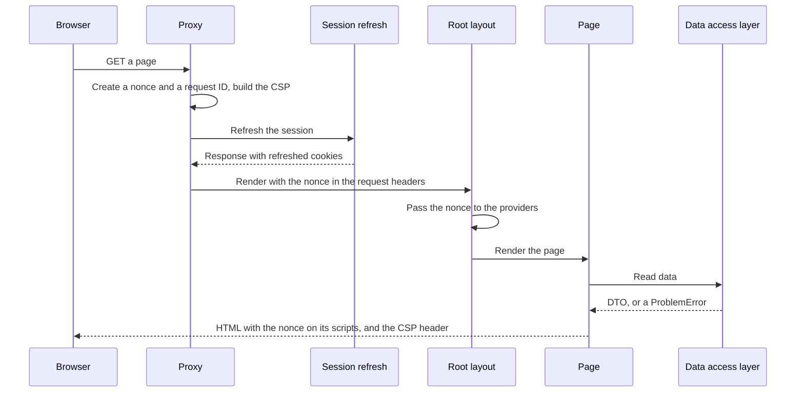
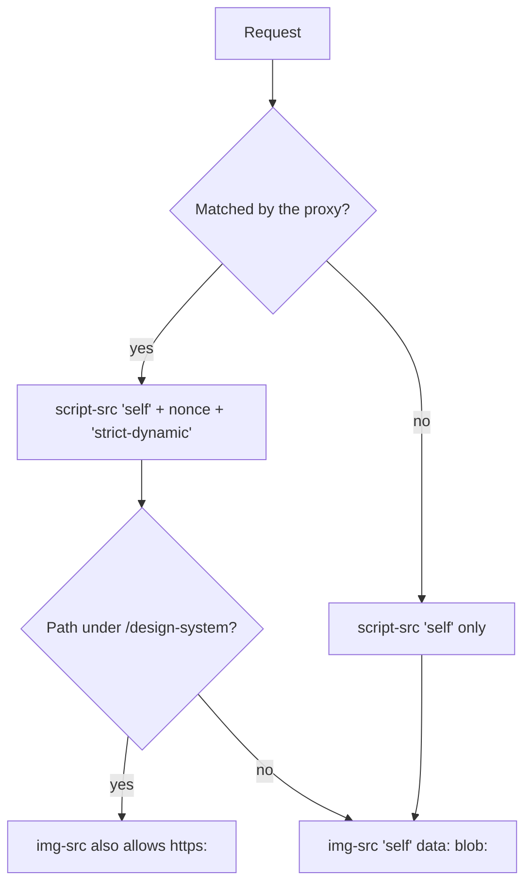
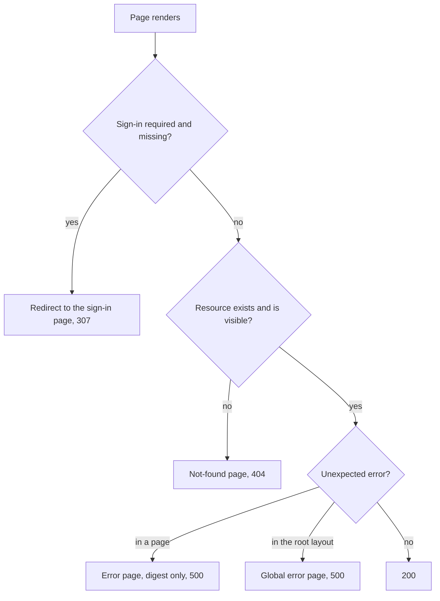

# Request flow

What happens to a page request: the proxy, the security headers, rendering, and the response a page gives when sign-in is missing, a resource is missing, or rendering fails.

## A page request

- The proxy matches every path except static files, image optimization, and image and font files, so Route Handlers and Server Actions pass through it too.
- The session refresh is described in [Auth](auth.md#refreshing-an-expired-session). Without the Supabase variables it does nothing, but the proxy still sets the CSP.
- The root layout reads the `x-nonce` request header and passes the nonce to next-themes and Base UI (`CSPProvider`). Next.js puts it on its own scripts.
- Reading the nonce makes every page render per request, so there is no static generation.
- The request ID (`x-request-id`) goes only to the server, for the [server logs](logging.md). It replaces any value the client sent and is not returned.

## Which CSP a response gets

- A request the proxy skips gets only the `next.config.ts` CSP, with no nonce, so any inline script in it fails closed.
- `'strict-dynamic'` trusts the bundles that nonced scripts load, so Next.js chunks need no allowlist.
- `/design-system` allows external images because its sample cards load photos from other sites.
- Styles are not restricted, because a nonce does not cover the `style=` attributes the components use.
- In development, `script-src` also allows `'unsafe-eval'`, which React uses for debugging information.

`next.config.ts` adds these headers to every response and turns off `X-Powered-By`:

| Header | Value | Role |
| --- | --- | --- |
| `Content-Security-Policy` | From `lib/csp.ts`. Content from this origin only; connections only to this origin, Supabase, and Sentry; `frame-ancestors 'none'`, `base-uri 'self'`, `form-action 'self'`, `object-src 'none'` | Blocks clickjacking, `<base>` hijacking, data sent elsewhere, plugins, and scripts without this request's nonce |
| `X-Frame-Options` | `DENY` | Framing protection for older browsers |
| `X-Content-Type-Options` | `nosniff` | Stops MIME sniffing |
| `Referrer-Policy` | `strict-origin-when-cross-origin` | Sends only the origin to other sites |
| `Permissions-Policy` | camera, microphone, geolocation, browsing-topics off | Denies powerful features by default |
| `Strict-Transport-Security` | one year | Forces HTTPS; `includeSubDomains` / `preload` wait until every subdomain serves HTTPS |

## Page responses

- Pages call `requirePageUser()`, which redirects. `requireUser()` throws a 401 Problem, which a page calling it directly would show as an unexpected error. A 401 thrown inside a `data/` call is different: `loadForPage()` redirects it to sign-in too.
- A forbidden resource answers 404 like a missing one, so its existence is not revealed. `loadForPage()`, around each `data/` call, turns the 403 into the not-found page (see [Errors](errors.md#server-pieces)).
- The error pages show only the digest, because an error message can carry internal details.
- There is no root `loading.tsx`: a root loading boundary streams every page, after which `redirect()` and `notFound()` can no longer set the status code.

## Key files

| File | Role |
| --- | --- |
| `proxy.ts` | Nonce, CSP header, request ID, session refresh |
| `lib/supabase/proxy.ts` | `updateSession()`, the session refresh step |
| `lib/csp.ts` | Builds the CSP for `next.config.ts` and the proxy |
| `next.config.ts` | Security headers on every response |
| `app/layout.tsx` | Passes the nonce to the providers |
| `app/error.tsx`, `app/global-error.tsx`, `app/not-found.tsx` | Error pages |

## Related rules

- [Security boundary](../AGENTS.md#security-boundary-client--server): pages, error pages, security headers
