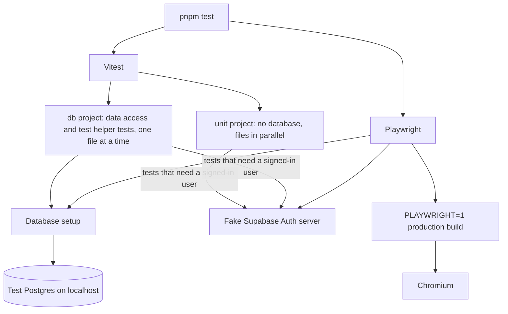
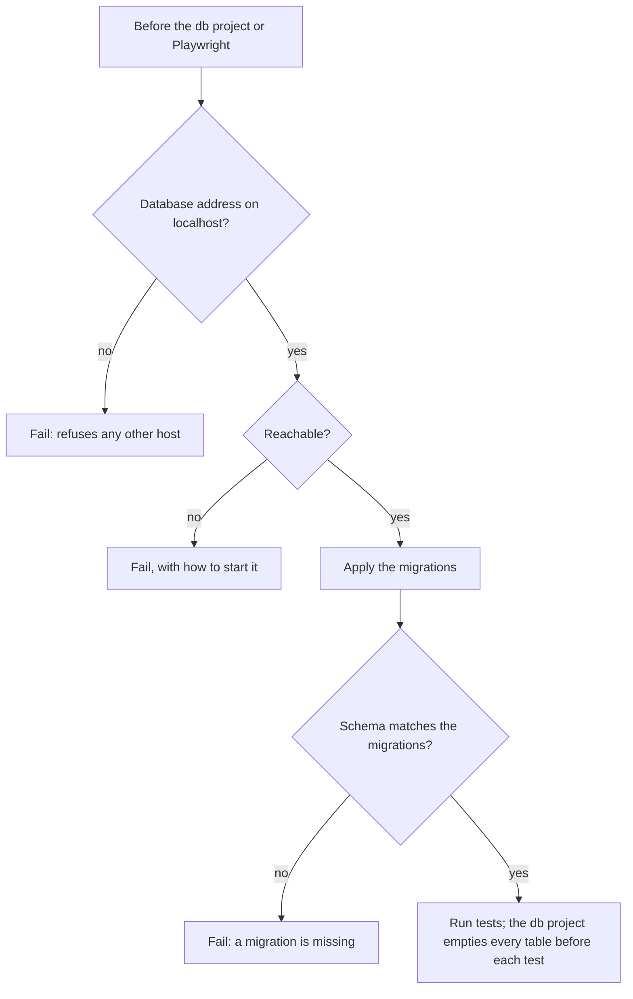

# Testing

What each test tool runs against. Tests never reach a real external service, so they need no secrets, locally or in CI.

## Tools and what they run against

| Dependency | In tests | Why |
| --- | --- | --- |
| Database | A real, disposable Postgres: `docker-compose.test.yaml` locally, the same image as a CI service container | Authorization and constraints in the data access layer are the only line of defense, and a mocked Prisma would pass them all |
| Supabase Auth | A local fake server that serves the signing keys and answers refresh-token exchanges. Tokens are really signed, so `getClaims()` really verifies them | The tests cover how this code handles Supabase, not Supabase itself |
| Sentry | Vitest mocks it; Playwright intercepts what the browser sends | Nothing is ever sent |

The fake server's signing key comes from a fixed seed, so the server and the tests agree on it without a key stored in the repository.

## Test database setup

- The tests empty every table, so the localhost check keeps them away from any shared database. `TEST_DATABASE_URL` can override the default address, but only with another localhost address.
- A down database fails the run instead of skipping tests, so a green run always means the data access layer was tested.
- Only the data access layer touches the database, so tests above it mock the data access functions they call.
- When many tests build the same records, add a factory per model under `test-utils/`.
- RLS is not tested, because no table is exposed through the Data API. Once one is, its policies need the Supabase local stack, as a separate test lane.

## Playwright

- It starts the fake Auth server, then builds and starts the app with `PLAYWRIGHT=1`, pointing it at the test database and the fake server.
- Pages built only for Playwright, some of which fail on purpose, live in `app/playwright/` as `page.playwright.tsx`. Only a `PLAYWRIGHT=1` build treats them as pages, so they never ship.
- Playwright overwrites `.next`, so rebuild with `pnpm build` before deploying from the same folder.

## Shared helpers

`test-utils/shared/` holds what both tools use and imports no test tool; `vitest/` and `playwright/` wrap it.

| Helper | Role |
| --- | --- |
| `shared/supabase-auth.ts` | Fake Auth server and session cookies: valid, anonymous, non-user role, forged, expired, revoked, unanswered |
| `shared/test-database.ts` | Test database address, localhost-only guard, `resetDatabase()` |
| `shared/database-setup.ts` | The database setup in the diagrams above |
| `vitest/setup.ts` | Runs before every Vitest file: mocks Sentry (`sentryReports()`) and `next/headers` (`setRequestCookies()`), and silences error and warning logs (`loggedErrors()`, `loggedWarnings()`) |
| `vitest/database.ts` | Points the db project at the test database and empties it before each test |
| `vitest/helpers.ts` | `thrown()`, and `importWithEnv()` to reload a module with other variables |
| `vitest/supabase-auth.ts` | `fakeSupabaseAuth()` starts the fake Auth server for one test file, for any test that needs a signed-in user |
| `playwright/supabase-auth.ts`, `playwright/supabase-auth-server.mjs` | Fixed Auth address for the build, the server entry, `sessionCookieHeader()` |
| `playwright/app.ts` | The `NEXT_PUBLIC_APP_NAME` the Playwright build uses |
| `playwright/sentry.ts` | `captureSentryEvents()` intercepts the browser's reports |

## What the tests cover

| Test file | Covers |
| --- | --- |
| `lib/problem.vitest.test.ts`, `lib/ky.vitest.test.ts` | The Problem contract, kebab-case problem type names, and how the client reads a Problem |
| `lib/server/*.vitest.test.ts` | Error mapping, including a raw zod error as a reported 500, input validation, error handlers, `redirect()` passthrough |
| `lib/auth.vitest.test.ts` | Requester identity for every kind of token, refreshing an expired one, and the Auth time limit |
| `lib/supabase/*.vitest.test.ts` | The Auth time limit, the proxy's session refresh with and without an answer, and refreshed session cookies marked Secure only in production builds |
| `eslint.config.vitest.test.ts` | The server boundary rules, including every known bypass |
| `instrumentation.vitest.test.ts` | Server errors are logged and reach Sentry through `onRequestError` |
| `lib/sentry/options.vitest.test.ts` | The options every runtime shares: off without a DSN and on with one, minimal data collection, and only sampled performance traces |
| `lib/csp.vitest.test.ts` | The CSP's base directives, connections to the Supabase origin, its websocket, and the Sentry origin, `script-src 'self'` alone without a nonce, the nonce with `'strict-dynamic'` and no `'unsafe-inline'` in production, `'unsafe-eval'` only in development, and external images only on the showcase |
| `lib/query-client.vitest.test.ts` | No retry on a 4xx, one retry on a 5xx or network error, a new client per server request and one client in the browser, a one-minute stale time, and no refetch on window focus |
| `lib/server/logger.vitest.test.ts` | Log line format, service and environment fields, redaction, exceptions, never throwing |
| `config/env.vitest.test.ts` | Environment variable parsing, and when the showcase opens |
| `data/db.vitest.test.ts` | The data access layer reaches the test database, never the one in `.env` |
| `test-utils/shared/test-database.vitest.test.ts` | The localhost-only guard and the table reset |
| `docs/docs.vitest.test.ts` | Docs, the AGENTS.md structure tree, environment variable lists, the two skill folders, and the CLAUDE.md list of skills and subagents stay in step (see [Writing these docs](README.md#keeping-docs-current)) |
| `.claude/hooks/*.vitest.test.ts` | The subagent hooks block the docs writer's edits outside the docs Markdown, and every Bash command but the read-only ones the subagents share, including git options that write a file when quoted, abbreviated, or brace-expanded |
| `app/(design-system)/components/showcase.vitest.test.ts` | Every component in `components/ui/` and `components/shared/` is in the showcase, and every card is registered |
| `app/global-error.vitest.test.ts` | The root-layout error page shows the digest, never the error |
| `app/app.playwright.test.ts` | In a real browser, against a production build: security headers and nonce, status codes, sign-in handling, session refresh, error pages, Sentry reports, pages downloading only the Pretendard weights they use, characters Pretendard lacks falling back to Noto Sans served from this origin, and a toast shown through the app-wide Toaster |

## Key files

| File | Role |
| --- | --- |
| `vitest.config.mts` | Vitest projects `unit` and `db` |
| `playwright.config.ts` | Fake Auth server, `PLAYWRIGHT=1` build, test database |
| `docker-compose.test.yaml` | The local test database |
| `test-utils/` | Shared setup and helpers |
| `app/playwright/` | Pages built only for Playwright |

## Related rules

- [Commands](../AGENTS.md#commands): test file naming, shared helpers, what tests run against, Vitest projects, when to run which test
