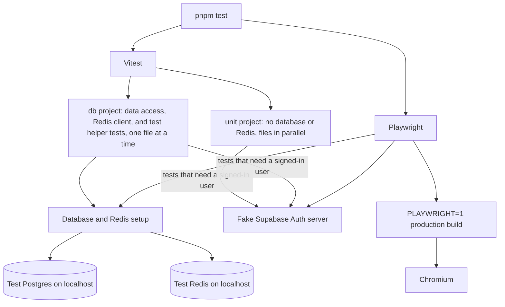
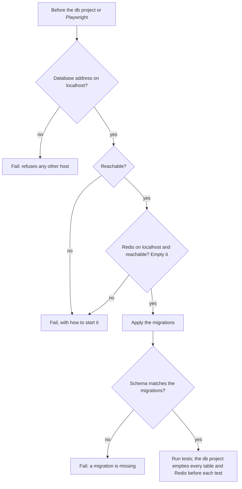

# Testing

What each test tool runs against. Tests never reach a real external service, so they need no secrets, locally or in CI.

## Tools and what they run against

| Dependency | In tests | Why |
| --- | --- | --- |
| Database | A real, disposable Postgres: `docker-compose.test.yaml` locally, the same image as a CI service container | Authorization and constraints in the data access layer are the only line of defense, and a mocked Prisma would pass them all |
| Redis | A real, disposable Redis without persistence: `docker-compose.test.yaml` locally, the same image as a CI service container, given the same settings once it is up | The client's connection handling behaves as in production only against a real server |
| Supabase Auth | A local fake server that serves the signing keys and answers refresh-token exchanges. Tokens are really signed, so `getClaims()` really verifies them | The tests cover how this code handles Supabase, not Supabase itself |
| Sentry | Vitest mocks it; Playwright intercepts what the browser sends | Nothing is ever sent |
| Chat service | Vitest mocks `@/lib/notify`; the tests of `lib/notify` itself import its modules directly and stub `fetch`. See [Notifications](notifications.md#notifications-in-tests) | Nothing is ever sent; tests check which kind of notification code asked to send, and with what data |

The fake server's signing key comes from a fixed seed, so the server and the tests agree on it without a key stored in the repository.

Vitest runs `*.vitest.test.ts` and `*.vitest.test.tsx`. There is no DOM: a `.tsx` test renders a component on the server with `react-dom/server` and checks the markup, as `app/not-found.vitest.test.tsx` does, and behaviour in the browser stays with Playwright. `tsconfig.build.json` and `.dockerignore` leave both kinds out of the build.

## The test environment

Every test runs with the variables in the committed `.env.test`, never those in `.env`, so a developer's own secrets and services never reach a test (see [Commands](../AGENTS.md#commands)). Vitest sets them for every test in its first setup file (`test-utils/vitest/env.ts`), so the config itself loads no project module; Playwright passes them, with `PLAYWRIGHT=1` and the fake Auth server's address, to the app server it builds and starts.

- `next build` and `next start` load `.env` (and `.env.local` or `.env.production*` when present), but never replace a variable that is already set, an empty one included. `.env.test` lists every variable in `.env.example`, so those files fill in none of them; only a variable missing from `.env.example` could still reach the Playwright server, which is one more reason every variable goes there.
- An empty value means unset, so notifications and the Sentry source map upload stay off. The Sentry DSN is an address nothing listens on.
- Its `DATABASE_URL` and `REDIS_URL` are the test services (ports 5433 and 6380), and the only addresses the test helpers use.

## Test database setup

- The tests empty every table and the whole Redis database, so the localhost checks keep them away from any shared database or Redis. Both addresses come only from `.env.test`, so the ones in `.env` are never reached.
- A down database or Redis fails the run instead of skipping tests, so a green run always means the data access layer was tested. Playwright goes through the same setup and starts the app with the test Redis, so it needs the test Redis too.
- Only the data access layer touches the database and Redis, so tests above it mock the data access functions they call.
- When many tests build the same records, add a factory per model under `test-utils/`.
- RLS is not tested, because no table is exposed through the Data API. Once one is, its policies need the Supabase local stack, as a separate test lane.

## Playwright

- It starts the fake Auth server, then builds and starts the app with the [test environment](#the-test-environment), `PLAYWRIGHT=1`, and the fake server's address. The database and Redis addresses must be on localhost before anything starts.
- Pages built only for Playwright, some of which fail on purpose, live in `app/playwright/` as `page.playwright.tsx`. Only a `PLAYWRIGHT=1` build treats them as pages, so they never ship.
- Playwright overwrites `.next`, so rebuild with `pnpm build` before deploying from the same folder.

## Shared helpers

`test-utils/shared/` holds what both tools use and imports no test tool; `vitest/` and `playwright/` wrap it.

| Helper | Role |
| --- | --- |
| `shared/supabase-auth.ts` | Fake Auth server and session cookies: valid, anonymous, non-user role, forged, expired, revoked, unanswered |
| `shared/test-env.ts` | `TEST_ENV`, the variables in `.env.test` |
| `shared/test-database.ts` | Test database address from `.env.test`, localhost-only guard, `resetDatabase()` |
| `shared/test-redis.ts` | Test Redis address from `.env.test`, localhost-only guard, `resetRedis()` |
| `shared/database-setup.ts` | The database and Redis setup in the diagrams above |
| `vitest/setup.ts` | Runs before every Vitest file: mocks Sentry (`sentryReports()`), `@/lib/notify` while still defining kinds for real (`sentNotifications()`, the kind name and data of each `notify()` call in the current test), and `next/headers` (`setRequestCookies()`), and silences error and warning logs (`loggedErrors()`, `loggedWarnings()`) |
| `vitest/database.ts` | Empties the test database and Redis before each test of the db project |
| `vitest/env.ts` | The first setup file of every Vitest file: puts the variables in `.env.test` into the environment before the test file loads any module that reads them |
| `vitest/definition-files.ts` | The shared check on folders with one definition per file: kinds of notification and Redis models |
| `vitest/helpers.ts` | `thrown()`, and `importWithEnv()` to reload a module with other variables |
| `vitest/supabase-auth.ts` | `fakeSupabaseAuth()` starts the fake Auth server for one test file, for any test that needs a signed-in user. `load()` imports the module under test with Supabase pointing at the fake server, and `signIn()` / `signOut()` set the requester's session cookie. Supabase is off in `.env.test` and whether it is on is fixed when a module loads, so a module imported statically sees every caller as signed out |
| `playwright/supabase-auth.ts`, `playwright/supabase-auth-server.mjs` | Fixed Auth address for the build, the server entry, `sessionCookieHeader()` |
| `playwright/server-env.ts` | `playwrightServerEnv()`, the app server's environment: `.env.test`, `PLAYWRIGHT=1`, the fake Auth address |
| `playwright/sentry.ts` | `captureSentryEvents()` intercepts the browser's reports |

## What the tests cover

| Test file | Covers |
| --- | --- |
| `lib/problem.vitest.test.ts`, `lib/ky.vitest.test.ts` | The Problem contract, kebab-case problem type names, and how the client reads a Problem |
| `lib/server/*.vitest.test.ts` | Error mapping, including a raw zod error as a reported 500, input validation, error handlers, `redirect()` passthrough, and `loadForPage()`: not found for a 404 or 403, sign-in for a 401, anything else rethrown |
| `lib/auth.vitest.test.ts` | Requester identity for every kind of token, refreshing an expired one, and the Auth time limit |
| `lib/supabase/*.vitest.test.ts` | The Auth time limit, the proxy's session refresh with and without an answer, and refreshed session cookies marked Secure only in production builds |
| `eslint.config.vitest.test.ts` | The server boundary rules, including server-only modules blocked in `domains/` (also relative and dynamic imports) while schemas, problem types, the browser Prisma build, and server types stay importable, the Server Action and Route Handler export rules, and the notify import rule: `import { notify }` allowed in Server Action files and Route Handlers and blocked elsewhere, also when relative or renamed; namespace, dynamic, `require()`, template literal, re-export, and `sendNotification()` forms blocked, and namespace, dynamic, re-export, and `sendNotification()` in entry points too; importing the notifier, a provider, or `kind.ts` (also relative or dynamic) blocked in app files and Route Handlers; kinds and types importable anywhere, types also from the module's own files, and `notify` through `@/lib/notify/index` |
| `prisma/models.vitest.test.ts` | The model conventions on every model file, the pinned Prisma versions, and, with example schemas, the check itself |
| `instrumentation.vitest.test.ts` | Server errors are logged and reach Sentry through `onRequestError` |
| `lib/sentry/options.vitest.test.ts` | The options every runtime shares: off without a DSN and on with one, minimal data collection, and only sampled performance traces |
| `lib/sentry/server.vitest.test.ts` | The server Sentry setup records no span or breadcrumb for the notification webhook, and ignores nothing without one |
| `lib/csp.vitest.test.ts` | The CSP's base directives, connections to the Supabase origin, its websocket, and the Sentry origin, `script-src 'self'` alone without a nonce, the nonce with `'strict-dynamic'` and no `'unsafe-inline'` in production, `'unsafe-eval'` only in development, and external images only on the showcase |
| `lib/query-client.vitest.test.ts` | No retry on a 4xx, one retry on a 5xx or network error, a new client per server request and one client in the browser, a one-minute stale time, and no refetch on window focus |
| `lib/server/logger.vitest.test.ts` | Log line format, service and environment fields, redaction, exceptions, never throwing |
| `lib/notify/**/*.vitest.test.ts` | Sending after the response, skipping without a destination, the https-only variable, render and send failures logged without the webhook URL, flat data and kebab-case names for kinds, the layout of the files in `notifications/`, the global mock, the chat message format, escaping, limits, and the single 429 retry |
| `lib/redis/client.vitest.test.ts` | Against the test Redis: no client without `REDIS_URL`, one reused connection, and an unreachable server rejected, tried again on the next call, and logged without its address |
| `lib/redis/model.vitest.test.ts`, `lib/redis/model-files.vitest.test.ts` | Redis model keys, kebab-case names, write options (no TTL by default, a whole-second TTL on request), value checks, and value types, and the layout of the files in `redis/models/` |
| `config/env.vitest.test.ts` | Environment variable parsing, and when the showcase opens |
| `config/env.server.vitest.test.ts` | Both env modules load with `.env.example` copied as is. Server variable parsing: empty values as unset, the defaults, the `DATABASE_POOL_MAX` range (a whole number from 1 to 100), and an invalid database address, a non-`https` webhook, or a non-Redis address failing at load with the variable's name |
| `data/db.vitest.test.ts` | The data access layer reaches the test database, never the one in `.env` |
| `test-utils/shared/test-database.vitest.test.ts`, `test-utils/shared/test-redis.vitest.test.ts` | The localhost-only guards, the table reset, and the Redis reset |
| `test-utils/shared/test-env.vitest.test.ts`, `test-utils/playwright/server-env.vitest.test.ts` | `.env.test` lists exactly the variables in `.env.example`, points only at this machine, keeps notifications and the source map upload off, and is the environment of every Vitest test and of the Playwright app server, which changes only `PLAYWRIGHT` and the Supabase variables |
| `docs/docs.vitest.test.ts` | Docs, the AGENTS.md structure tree, environment variable lists, the two skill folders, and the CLAUDE.md list of skills and subagents stay in step (see [Writing these docs](README.md#keeping-docs-current)) |
| `.claude/hooks/*.vitest.test.ts` | The subagent hooks block the docs writer's edits outside the docs Markdown, and every Bash command but the read-only ones the subagents share, including git options that write a file when quoted, abbreviated, or brace-expanded |
| `app/(design-system)/components/showcase.vitest.test.ts` | Every component in `components/ui/` and `components/shared/` is in the showcase, and every card is registered |
| `test-utils/vitest/supabase-auth.vitest.test.ts` | `fakeSupabaseAuth()` signs a requester in and out for a module loaded with `load()`, and a module imported without it sees every caller as signed out |
| `app/global-error.vitest.test.ts` | The root-layout error page shows the digest, never the error |
| `app/not-found.vitest.test.tsx` | The not-found page, rendered on the server, says the page was not found and links home |
| `app/app.playwright.test.ts` | In a real browser, against a production build: security headers and nonce, status codes, sign-in handling, session refresh, error pages, Sentry reports, pages downloading only the Pretendard weights they use, characters Pretendard lacks falling back to Noto Sans served from this origin, and a toast shown through the app-wide Toaster |

## Key files

| File | Role |
| --- | --- |
| `.env.test` | The environment of every test |
| `vitest.config.mts` | Vitest projects `unit` and `db`, and the setup files every test runs |
| `playwright.config.ts` | Fake Auth server, `PLAYWRIGHT=1` build started with `.env.test`, localhost checks |
| `docker-compose.test.yaml` | The local test database and test Redis |
| `test-utils/` | Shared setup and helpers |
| `app/playwright/` | Pages built only for Playwright |

## Related rules

- [Commands](../AGENTS.md#commands): test file naming, shared helpers, what tests run against, `.env.test`, Vitest projects, when to run which test
- [Environment variables](../AGENTS.md#environment-variables): a test value in `.env.test` for every new variable
